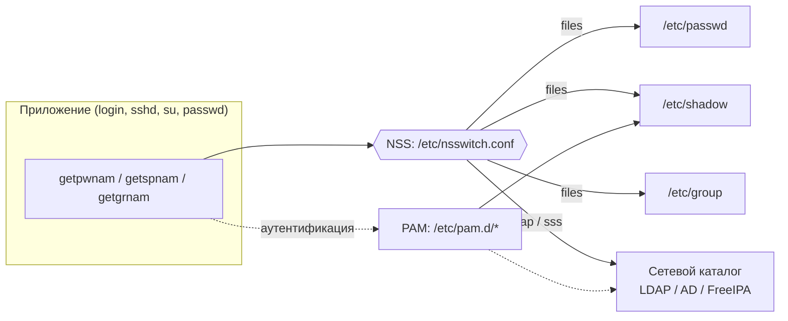
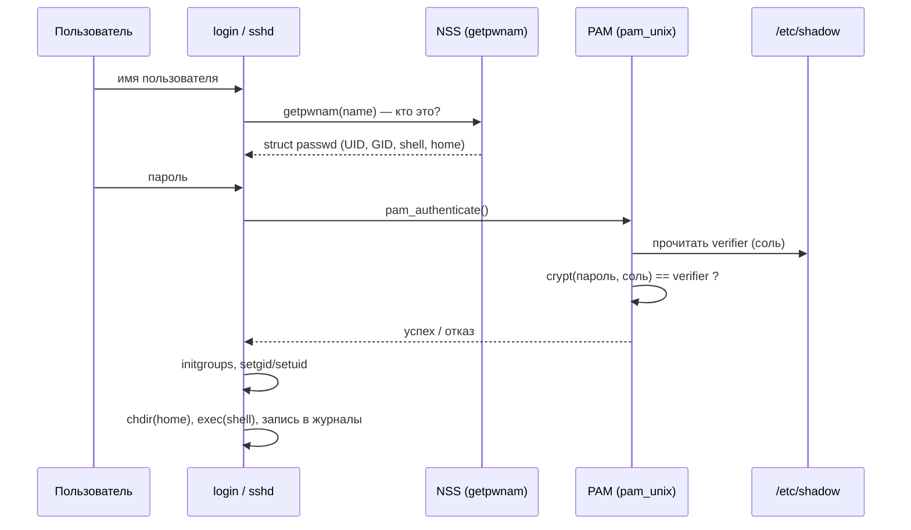

# Лекция 2

## Классические механизмы управления пользователями в ОС Unix

Ubuntu Server 26.04 LTS · локальные учётные записи → централизованный каталог

<!--
90 минут: введение 8; passwd 12; group 8; shadow и криптография 22;
управление 8; логин и журналы 10; sudo 8; NSS/LDAP 10; атаки и итоги 4.
LDAP-VM подготовить заранее. Полный прогон всех демо — дополнительный практикум.
Терминальные окна на слайдах — захваченный вывод демо-сценариев (assets/captures).
-->

---

# Что будем уметь

- Читать базы пользователей и групп и связывать поля с C API.
- Отличать имя учётной записи от числовых полномочий процесса.
- Объяснять проверку пароля, блокировку и срок действия.
- Управлять пользователями и ограниченными правилами sudo.
- Читать журналы входов и объяснять, откуда берутся их записи.
- Проследить запрос от login через NSS к LDAP-каталогу.

<div class="mt-4 p-3 border-l-4 border-teal-500 bg-teal-500/10 text-sm">
Терминальные окна на слайдах — <b>захваченный вывод</b> демо-сценариев в одноразовой
среде; UID, даты и хэши зависят от VM. Полные сценарии с защитными проверками —
<code>assets/demos/01-*.sh … 11-*.sh</code>; инструкция — в их README.
</div>

---
layout: default
---

# План лекции

<div class="grid grid-cols-2 gap-x-8 gap-y-1 text-sm mt-2">

<div>

1. Введение: IAM и терминология
2. Файл паролей `/etc/passwd`
3. Файлы групп `/etc/group` и `/etc/gshadow`
4. Теневой файл `/etc/shadow`, структура хэша
5. Соль, перец, timing-атаки, KDF

</div>
<div>

6. Управление пользователями: `useradd`/`usermod`/`userdel`
7. Процедура логина и журналы входов
8. `sudo` и `su`
9. Name Service Switch (NSS) и LDAP
10. Атаки на аутентификацию; итоги; источники

</div>
</div>

<div class="abs-b mx-14 my-6 text-xs opacity-60">
Демонстрации — нумерованные сценарии <code>assets/demos/01-*.sh … 11-*.sh</code>;
их захваченный вывод — <code>assets/captures/</code>
</div>

---
layout: section
---

# 1. Введение
## Терминология и состав механизмов IAM в Unix

---

# IAM: определение

<v-clicks>

**IAM** (Identity and Access Management, управление идентификацией и доступом) —
совокупность процессов и механизмов, обеспечивающих:

- **Identification (идентификация)** — сопоставление субъекту уникального идентификатора (имя, **UID**);
- **Authentication (аутентификация)** — проверка, что субъект тот, за кого себя выдаёт (пароль, ключ, биометрия);
- **Authorization (авторизация)** — определение прав субъекта на операции над объектами (права доступа, группы, `sudo`).

</v-clicks>

<v-click>

<div class="mt-4 p-3 border-l-4 border-teal-500 bg-teal-500/10 text-sm">
В классическом Unix «пользователь» для ядра — это <b>число</b> (UID/GID). Имена существуют
лишь для удобства человека и разрешаются в числа через базы данных пользователей.
</div>

</v-click>

<!--
Ключевая мысль, к которой вернёмся в демо 01: ядро оперирует числами, имя — вторично.
-->

---

# Терминология нормативных документов

<div class="text-sm">

| Термин | Определение (сокращённо) | Источник |
|---|---|---|
| Субъект доступа | Лицо **или процесс**, действия которого регламентируются правилами разграничения доступа | РД Гостехкомиссии России, 1992 |
| Объект доступа | Единица информационного ресурса, доступ к которой регламентируется | РД Гостехкомиссии России, 1992 |
| Идентификация | Присвоение идентификаторов и сравнение предъявленного идентификатора с перечнем присвоенных | ГОСТ Р 58833-2020 |
| Аутентификация | Проверка принадлежности предъявленного идентификатора субъекту и подтверждение его подлинности | ГОСТ Р 58833-2020 |

</div>

<div class="mt-3 text-sm">

В Linux субъект — это **процесс**: пользователь действует только через процессы,
а дочерние процессы наследуют UID/GID родителя. Текущие полномочия процесса видны в
`/proc/PID/status` (строки `Uid:`/`Gid:`).

</div>

<div class="text-xs opacity-70 mt-2">
Факторы аутентификации: знание (пароль), владение (ключ, токен), биометрия.
Виды: односторонняя, взаимная, многофакторная (ГОСТ Р 58833-2020). Сегодня — парольная,
односторонняя; остальные — в лекции 3 (PAM).
</div>

---

# Краткая история

<div class="text-sm">

| Год | Событие |
|-----|---------|
| 1971 | Unix V1: файл `/etc/passwd` с паролями в открытом виде, затем — хэш |
| 1970-е | Хэш пароля хранится прямо в `/etc/passwd` (читаемом всеми) |
| 1988 | **Червь Морриса**: атака по словарю на хэши из читаемого `passwd` |
| ~1987–90 | **Shadow-пароли**: хэш выносится в `/etc/shadow` (0640, root) |
| 1980-е | **NIS** (Sun, «Yellow Pages») — сетевая база пользователей |
| 1990-е | **NSS** и **PAM** — модульность источников и методов аутентификации |
| 1993+ | **LDAP**, позже **Active Directory**, **SSSD** — централизованные каталоги |

</div>

<v-click>

<div class="mt-3 text-sm opacity-80">
Классические механизмы — <b>файловые</b>: <code>/etc/passwd</code>, <code>/etc/group</code>,
<code>/etc/shadow</code>, <code>/etc/gshadow</code>. Они остаются базовым уровнем даже при
использовании сетевых каталогов.
</div>

</v-click>

---

# Состав классических механизмов



<div class="text-xs opacity-70 mt-2">
Два независимых механизма: <b>NSS</b> отвечает на вопрос «кто это?» (данные учётной записи),
<b>PAM</b> — «пустить ли?» (проверка пароля, политики). NSS сам по себе <b>не проверяет пароль</b>.
Сегодня рассматриваем данные и файловые источники; PAM подробно — в лекции 3.
</div>

---
layout: section
---

# 2. Файл паролей
## <code>/etc/passwd</code>

---

# `/etc/passwd`: назначение и формат

Текстовый файл; одна строка — одна учётная запись; **7 полей**, разделённых `:`

```text
name : passwd : UID : GID : GECOS : home_dir : shell
  1  :   2    :  3  :  4  :   5   :    6     :   7
```

<div class="grid grid-cols-2 gap-4 mt-2 text-sm">
<div>

- **name** — имя для входа
- **passwd** — исторически хэш; сейчас `x` (хэш в `/etc/shadow`); пустое поле — потенциально беспарольный вход
- **UID** — числовой идентификатор пользователя
- **GID** — первичная группа

</div>
<div>

- **GECOS** — полное имя / комментарий (истор. «General Electric Comprehensive OS»)
- **home_dir** — домашний каталог
- **shell** — интерпретатор при входе

</div>
</div>

<div class="text-xs opacity-70 mt-2">
Поля строки напрямую соответствуют членам структуры <code>struct passwd</code> — см. далее.
</div>

---

# C API: `struct passwd` из &lt;pwd.h&gt;

```c
#include <pwd.h>
struct passwd {
    char   *pw_name;   // Имя пользователя (поле 1)
    char   *pw_passwd; // Хэш пароля ИЛИ "x" -> см. shadow (поле 2)
    uid_t   pw_uid;    // Числовой идентификатор пользователя (поле 3)
    gid_t   pw_gid;    // Числовой идентификатор первичной группы (поле 4)
    char   *pw_gecos;  // Комментарий / полное имя (поле 5)
    char   *pw_dir;    // Домашний каталог (поле 6)
    char   *pw_shell;  // Командный интерпретатор (поле 7)
};

struct passwd *getpwnam(const char *name);
struct passwd *getpwuid(uid_t uid);
```

<div class="text-xs opacity-70 mt-1">
<code>getpwnam(3)</code>, <code>getpwuid(3)</code>, <code>getpwent(3)</code> работают через NSS.
Для многопоточного кода — реентерабельные <code>getpwnam_r</code>/<code>getpwuid_r</code>.
Источник: <a href="https://man7.org/linux/man-pages/man3/getpwnam.3.html">getpwnam(3)</a>.
</div>

---

# Права доступа к `/etc/passwd`

```console
$ stat -c '%a %U:%G %n' /etc/passwd /etc/shadow
644 root:root /etc/passwd
640 root:shadow /etc/shadow
```

<div class="grid grid-cols-2 gap-6 mt-3 text-sm">
<div>

**Кто читает:** `0644` — **читают все**.

Файл обязан быть общедоступным: множество программ отображают
UID→имя (`ls -l`, `ps`, `stat`).

</div>
<div>

**Кто пишет:** только **root** (владелец).

Обычный пользователь меняет свои поля лишь через **SUID-утилиты**:
`passwd(1)`, `chsh(1)`, `chfn(1)`. Ручное редактирование администратором —
с блокировкой: `vipw(8)`.

</div>
</div>

<v-click>

<div class="mt-4 p-3 border-l-4 border-amber-500 bg-amber-500/10 text-sm">
<b>Проблема:</b> если хэш пароля лежит в общедоступном файле, любой пользователь
может скопировать его и вести офлайн-перебор по словарю. Именно это и произошло.
</div>

</v-click>

---

# Червь Морриса и вынесение хэша

<div class="grid grid-cols-2 gap-6 text-sm">
<div>

**2 ноября 1988.** Червь Морриса — одна из первых крупных сетевых атак.
Один из векторов — **атака по словарю** на хэши паролей, взятые прямо из
общедоступного `/etc/passwd` (Spafford, 1988).

Урок: хэш в читаемом всеми файле — приглашение к офлайн-перебору.

</div>
<div>

**Решение — shadow-пароли:**

- в `/etc/passwd` во 2-м поле остаётся `x`;
- хэш переносится в `/etc/shadow` с правами `0640 root:shadow`;
- туда же добавляются параметры парольной политики.

</div>
</div>

```text
До:     smith:$6$abc$Xk9...:1001:1001:John Smith:/home/smith:/bin/bash
После:  smith:x:1001:1001:John Smith:/home/smith:/bin/bash          (/etc/passwd)
        smith:$6$abc$Xk9...:20702:0:99999:7:::                      (/etc/shadow)
```

<!--
Червь Морриса — повод, но проблема носила системный характер: закрытое хранение
хэшей обсуждалось и раньше (Morris & Thompson, 1979). «Shadow изобрели только
из-за червя» — слишком категоричное утверждение.
-->

---

# Примеры строк `/etc/passwd`

```text {all}{maxHeight:'230px'}
root:x:0:0:root:/root:/bin/bash
daemon:x:1:1:daemon:/usr/sbin:/usr/sbin/nologin
bin:x:2:2:bin:/bin:/usr/sbin/nologin
sys:x:3:3:sys:/dev:/usr/sbin/nologin
sync:x:4:65534:sync:/bin:/bin/sync
www-data:x:33:33:www-data:/var/www:/usr/sbin/nologin
sshd:x:105:65534::/run/sshd:/usr/sbin/nologin
nobody:x:65534:65534:nobody:/nonexistent:/usr/sbin/nologin
systemd-resolve:x:991:991:systemd Resolver:/:/usr/sbin/nologin
user:x:1000:1000:,,,:/home/user:/bin/bash
```

<div class="grid grid-cols-3 gap-3 mt-2 text-xs">
<div class="p-2 border border-teal-500/40 rounded">
<b>root · UID 0</b><br/>суперпользователь; проверки прав пропускаются
</div>
<div class="p-2 border border-sky-500/40 rounded">
<b>UID 1–999</b><br/>системные/служебные псевдопользователи (демоны)
</div>
<div class="p-2 border border-violet-500/40 rounded">
<b>UID ≥ 1000</b><br/>обычные люди (<code>UID_MIN</code>/<code>UID_MAX</code> в login.defs)
</div>
</div>

<div class="text-xs opacity-70 mt-2">
Диапазоны задаются дистрибутивом (<code>login.defs</code>, у Debian/Ubuntu — политика
пакетной базы), а не ядром: для ядра любой UID — просто число.
</div>

---

# Специальные пользователи: назначение

<div class="text-sm">

| Пользователь | UID | Назначение |
|---|---|---|
| `root` | 0 | Суперпользователь: владелец системных файлов, обход проверок прав |
| `daemon` | 1 | Историческая запись; не универсальный владелец всех демонов |
| `bin`, `sys` | 2, 3 | Историческое владение системными бинарями/устройствами |
| `www-data` | 33 | От его имени работает веб-сервер; процессы получают его UID |
| `sshd` | 105 | Непривилегированное разделение привилегий в OpenSSH |
| `nobody` | 65534 | Минимальная общая идентичность; в т.ч. некоторые отображения NFS |

</div>

<div class="mt-3 p-3 border-l-4 border-teal-500 bg-teal-500/10 text-sm">
<b>Принцип наименьших привилегий:</b> каждая служба работает под собственной УЗ,
чтобы её компрометация не давала доступа к чужим данным и не требовала root.
UID служебных записей зависят от системы.
</div>

---

# Псевдопользователи и «запрещающие» оболочки

**Псевдопользователь** — служебная учётная запись для владения файлами
и выполнения процессов, обычно без интерактивного входа человека.

<div class="text-sm mt-2">

| Объект в 7-м (или 6-м) поле | Поведение |
|---|---|
| `/usr/sbin/nologin` | Сообщает об отказе, ненулевой код выхода; показывает `/etc/nologin.txt`, если есть |
| `/bin/false` | Немедленно завершает работу с кодом 1 — вход не удаётся |
| `/bin/true` | Немедленно завершает работу с кодом 0 — редкие специальные случаи |
| `/nonexistent`, `/dev/null` как home | «Пустой» домашний каталог служебной УЗ |

</div>

```console
$ sudo -u www-data /usr/sbin/nologin
This account is currently not available.
$ sudo -u daemon /bin/false; echo $?
1
```

<div class="text-xs opacity-70 mt-1">
<code>/dev/null</code> — не исполняемая оболочка и не каталог. <code>true</code> не даёт shell,
но успешный код важен вызывающей программе. Блокировка пароля и nologin не мешают
root запустить службу от этого UID.
</div>

---

# Демо 01: привилегии определяются UID, а не именем

<TerminalCapture src="captures/01-passwd-uid-zero.txt" section="3" title="demo 01 · подмена третьего поля" padBottom="2.4em">
  <TCallout v-click :line="4" :col="9" :span="1" label="3-е поле (UID) подменено на 0" side="bottom" />
</TerminalCapture>

<TerminalCapture src="captures/01-passwd-uid-zero.txt" section="4" title="demo 01 · результат" padBottom="2.4em">
  <TCallout v-click :line="2" :col="1" :span="11" label="имя осталось alice, но ядро видит root" side="bottom" color="#ff7a85" />
</TerminalCapture>

<div class="text-xs opacity-70 mt-1">
Сценарий курса <b>01-passwd-uid-zero.sh</b> выполняет то же через <code>vipw</code> и
<code>runuser</code>, затем возвращает UID. Уже запущенный процесс UID не меняет.
Это последствия права записи в базу, а не обход защиты — отсюда строгие права на
<code>/etc/passwd</code>: запись в него эквивалентна root-доступу.
</div>

---
layout: section
---

# 3. Файлы групп
## <code>/etc/group</code> и <code>/etc/gshadow</code>

---

# `/etc/group`: четыре поля

```text
group_name : passwd : GID : user1,user2,...
     1     :   2    :  3  :      4
```

<div class="grid grid-cols-2 gap-4 mt-2 text-sm">
<div>

- **group_name** — имя группы
- **passwd** — пароль группы: обычно `x` (→ `/etc/gshadow`) или пусто

</div>
<div>

- **GID** — числовой идентификатор группы
- **список** — **дополнительные** (вторичные) участники, через запятую

</div>
</div>

<div class="mt-3 p-3 border-l-4 border-teal-500 bg-teal-500/10 text-sm">
Первичная группа пользователя задаётся <b>не здесь</b>, а 4-м полем <code>/etc/passwd</code>
(<code>pw_gid</code>). Имя пользователя не обязано присутствовать в списке участников
его первичной группы.
</div>

---

# C API: `struct group` из &lt;grp.h&gt;

```c
#include <grp.h>
struct group {
    char   *gr_name;   // Имя группы            (поле 1)
    char   *gr_passwd; // Пароль группы / "x"   (поле 2, см. gshadow)
    gid_t   gr_gid;    // Числовой GID          (поле 3)
    char  **gr_mem;    // NULL-терминированный список имён участников (поле 4)
};

struct group *getgrnam(const char *name);
struct group *getgrgid(gid_t gid);
```

<div class="text-sm mt-2">
<code>getgrnam</code> получает одну запись. Полный список групп пользователя строится
через <code>getgrouplist(3)</code>/<code>initgroups(3)</code> с учётом NSS.
Чтение <code>/etc/group</code> — всем (<code>0644</code>), запись — root; пользователи — через
<code>gpasswd(1)</code>/<code>newgrp(1)</code>, администратор — <code>groupadd</code>/<code>groupmod</code>/<code>groupdel</code>, <code>vigr(8)</code>.
</div>

<div class="text-xs opacity-70 mt-1">
Источник: <a href="https://man7.org/linux/man-pages/man3/getgrnam.3.html">getgrnam(3)</a>.
</div>

---

# Демо 02: первичная и вторичные группы

<TerminalCapture src="captures/02-group-membership.txt" section="4" title="demo 02 · /etc/group и /etc/passwd" lines="1-5,9-10">
  <TCallout v-click :line="2" :col="9" :span="10" label="вторичное членство (4-е поле)" side="right" />
  <TCallout v-click :line="5" :col="1" :span="11" label="личная группа bob: список членов пуст" side="right" />
  <TCallout v-click :line="7" :col="12" :span="4" label="первичный GID — из /etc/passwd" side="right" color="#6cb6ff" />
</TerminalCapture>

<div class="text-sm mt-2">
<code>id bob</code> → <code>uid=1001(bob) gid=1001(bob) groups=1001(bob),4(adm),27(sudo),100(users)</code>:
<code>gid</code> — первичная группа из <code>passwd</code>, остальные — вторичные из <code>/etc/group</code>.
</div>

<div class="text-xs opacity-70 mt-1">
<b>02-group-membership.sh</b>. <code>id</code> без аргумента показывает группы <i>процесса</i>;
<code>id USER</code> — сведения из базы. Новая группа видна в сессии после нового входа.
</div>

---

# `/etc/gshadow` и пароль группы

**Пароль группы** позволяет пользователю, **не входящему** в группу, временно
получить её командой `newgrp(1)`/`sg(1)`, введя пароль. Формат — **4 поля**:

```text
group_name : пароль(хэш) : администраторы : члены
     1      :     2       :       3        :   4
```

<div class="text-sm mt-1">

- **2** — хэш пароля группы; `!`/пусто — вход по паролю запрещён (доступ только участникам);
- **3** — администраторы группы (меняют пароль и состав, `gpasswd -A`);
- **4** — члены (должны соответствовать списку в `/etc/group`).

</div>

```console
$ stat -c '%a %U:%G %n' /etc/gshadow
640 root:shadow /etc/gshadow
```

<div class="text-xs opacity-70 mt-1">
Проверяется пароль <b>группы при смене GID</b>, а не пароль вызова sudo. На практике
пароли групп применяются редко: чаще пользователя просто добавляют в группу. Пароль
административной группы расширяет доступ — на рабочей машине не задавать.
Источник: <a href="https://man7.org/linux/man-pages/man5/gshadow.5.html">gshadow(5)</a>.
</div>

---

# Демо 03: пароль на группу

<TerminalCapture src="captures/03-group-password.txt" section="2" title="demo 03 · до установки пароля" />

<TerminalCapture src="captures/03-group-password.txt" section="4" title="demo 03 · после chgpasswd" padBottom="2.4em">
  <TCallout v-click :line="5" :col="9" :span="3" label="SHA-512-crypt" side="top" />
  <TCallout v-click :line="5" :col="12" :span="30" label="хэш пароля группы (2-е поле)" side="bottom" />
</TerminalCapture>

<div class="text-sm mt-1">
Теперь <code>carol</code>, не будучи членом <code>project</code>, может выполнить
<code>newgrp project</code> и, введя пароль, временно получить эту группу как первичную.
</div>

<div class="text-xs opacity-70 mt-1">
Сценарий курса <b>03-group-password-sudo.sh</b> показывает тот же механизм на группе
<code>sudo</code> — наглядно, почему пароль административной группы опасен.
</div>

---
layout: section
---

# 4. Теневой файл паролей
## <code>/etc/shadow</code> и структура хэша

---

# `/etc/shadow`: девять полей

```text
name : hash : lstchg : min : max : warn : inact : expire : reserved
  1  :  2   :   3    :  4  :  5  :  6   :   7   :   8    :    9
```

<div class="grid grid-cols-2 gap-4 text-xs mt-1">
<div>

- **1 name** — имя пользователя
- **2 hash** — `$id$salt$hash`; `!`/`*` — вход по паролю запрещён; пусто — без пароля
- **3 lstchg** — день последней смены (от 1970-01-01 UTC)
- **4 min** — мин. дней до следующей смены
- **5 max** — макс. срок действия пароля

</div>
<div>

- **6 warn** — за сколько дней предупреждать
- **7 inact** — дней «неактивности» после истечения до блокировки
- **8 expire** — абсолютный день блокировки УЗ (от 1970)
- **9** — зарезервировано

</div>
</div>

```c
#include <shadow.h>
struct spwd {
    char *sp_namp;  char *sp_pwdp;   long sp_lstchg;  long sp_min;
    long  sp_max;   long  sp_warn;   long sp_inact;   long sp_expire;
    unsigned long sp_flag;
};
struct spwd *getspnam(const char *name);   // требует привилегий
```

<div class="text-xs opacity-70 mt-1">
Это Linux/glibc API, не переносимый интерфейс POSIX.
Источник: <a href="https://man7.org/linux/man-pages/man3/getspnam.3.html">getspnam(3)</a>.
</div>

---

# Блокировка пароля и другие способы входа

- **`!HASH`**: пароль заблокирован; старое значение может быть восстановлено.
- **`!` или `*`**: не являются допустимым результатом crypt — вход по паролю невозможен.
- Пустое поле: потенциально беспарольная проверка; итог зависит от PAM.
- `sp_lstchg = 0`: потребовать смену пароля при следующем входе.
- Пустой `sp_expire`: нет абсолютного срока учётной записи.

```console
$ passwd -l alice     # блокировать пароль
$ passwd -u alice     # разблокировать
$ chage -E 2026-12-31 alice
```

<div class="mt-3 p-3 border-l-4 border-amber-500 bg-amber-500/10 text-sm">
Блокировка <b>пароля</b> — не блокировка <b>учётной записи</b>: SSH-ключ может
продолжить работать при заблокированном пароле.
</div>

<div class="text-xs opacity-70 mt-1">
Источник: <a href="https://man7.org/linux/man-pages/man5/shadow.5.html">shadow(5)</a>.
</div>

---

# Кто имеет доступ к shadow

```console
$ stat -c '%a %U:%G %n' /etc/shadow /usr/bin/passwd /bin/login
640 root:shadow /etc/shadow
4755 root:root /usr/bin/passwd
755 root:root /bin/login
```

<div class="grid grid-cols-2 gap-6 mt-2 text-sm">
<div>

**Чтение:** только `root` и группа `shadow`; обычный пользователь не может
прочитать хэши. **Запись:** только `root`.

В других системах режим shadow бывает `600` или `000`; источник истины —
локальный `stat` на VM.

</div>
<div>

- `passwd` — **SUID root**: контролируемо повышает привилегии и проверяет, чью запись меняет;
- `login` запускается привилегированным getty — setuid ему не обязателен;
- PAM может использовать привилегированный помощник `unix_chkpwd`.

</div>
</div>

<div class="mt-3 p-3 border-l-4 border-teal-500 bg-teal-500/10 text-sm">
Разделение <code>passwd</code>/<code>shadow</code>: данные учётной записи общедоступны,
секрет (хэш) изолирован и доступен лишь доверенным утилитам. Обычному процессу
не дают все хэши ради проверки одного пользователя.
</div>

---

# Парольная политика: интервалы и абсолютная дата

Поля 4–8 — **aging**; управляются командой `chage(1)`:

```console
$ chage -m 0 -M 90 -W 7 -I 14 -E 2027-09-06 alice
$ chage -l alice
```

<div class="text-sm mt-1">

| Параметр | Поле | Смысл |
|---|---|---|
| `-m` / `PASS_MIN_DAYS` | min | нельзя менять пароль чаще, чем раз в N дней |
| `-M` / `PASS_MAX_DAYS` | max | пароль требует смены через N дней |
| `-W` / `PASS_WARN_AGE` | warn | предупреждать за N дней до истечения |
| `-I` | inact | блокировать через N дней после истечения |
| `-E` | expire | абсолютная дата блокировки учётной записи |

</div>

```text
last-change ─────── +90 → password expires ─── +14 → inactive
                           ↑ warning за 7 дней
account expires: отдельная абсолютная дата
```

<div class="text-xs opacity-70 mt-1">
min/max/warn/inactive — <b>интервалы</b>; expire — день календаря. Смена пароля сдвигает
вычисляемые даты от last-change, но не переписывает интервалы и абсолютный срок УЗ.
</div>

---

# Демо 04: `/etc/shadow` при смене пароля

<TerminalCapture src="captures/04-shadow-password-policy.txt" section="2" title="demo 04 · сразу после useradd" padBottom="2.2em">
  <TCallout v-click :line="2" :col="6" :span="1" label="'!' — пароля нет, вход по паролю запрещён" side="bottom" />
</TerminalCapture>

<TerminalCapture src="captures/04-shadow-password-policy.txt" section="6" title="demo 04 · после chage и passwd" lines="1-2" padBottom="2.6em">
  <TCallout v-click :line="2" :col="6" :span="3" label="алгоритм: yescrypt" side="top" />
  <TCallout v-click :line="2" :col="13" :span="22" label="соль — хранится открыто" side="bottom" />
  <TCallout v-click :line="2" :col="36" :span="43" label="результат KDF фиксированной длины" side="top" />
  <TCallout v-click :line="2" :col="80" :span="15" label="lstchg=20702 · min=1 · max=90 · warn=7 · inact=14" side="bottom" color="#6cb6ff" />
</TerminalCapture>

<div class="text-xs opacity-70 mt-1">
<b>04-shadow-password-policy.sh</b>. Поле lstchg — «сегодня» в днях от эпохи:
<code>$(( $(date +%s)/86400 ))</code>. <code>chage -l</code> показывает те же поля как даты.
Сценарий курса задаёт прошлую дату (<code>chage -d</code>): две смены в один день
не изменят поле с точностью до дня.
</div>

<!--
По клику пройти по полям хэша: id алгоритма, соль, digest, затем поля aging.
-->

---

# Что хранится вместо пароля

Формат **modular crypt format** (`crypt(5)`):

```text
password + salt + cost parameters → password KDF → verifier

$6$rounds=100000$CourseSalt$<86 символов>
 │       │           │              └─ результат SHA-512-crypt
 │       │           └─ открытая соль
 │       └─ параметр стоимости (есть не у всех алгоритмов)
 └─ идентификатор алгоритма

$y$j9T$<salt>$<digest>    # типичный формат yescrypt
```

<div class="text-sm mt-2">

- При проверке берутся сохранённые параметры и соль, вычисление повторяется,
  строки сравниваются. Пароль в открытом виде нигде не хранится.
- Это **не шифрование**: ключа для «расшифровки пароля» нет.
- Структура и разделители зависят от алгоритма.

</div>

---

# Алгоритмы (`crypt(5)`): формат ≠ обычный SHA(password)

<div class="text-sm">

| Формат | Алгоритм | Контекст |
|---|---|---|
| 13 символов без `$` | traditional DES crypt | Исторический, устарел |
| `$1$` / `$apr1$` | MD5-crypt / Apache | Устаревшие форматы |
| `$2a$`, `$2b$`, `$2y$` | **bcrypt** (Blowfish) | Адаптивный, свой формат cost |
| `$5$`, `$6$` | SHA-256-crypt, **SHA-512-crypt** | Итерированные; `$6$` долго был дефолтом |
| `$7$` | scrypt | Memory-hard формат libxcrypt |
| `$y$` / `$gy$` | **yescrypt** / gost-yescrypt | Дефолт Debian 11+/Ubuntu 22.04+; `$gy$` — с ГОСТ Р 34.11 |
| `$argon2id$` | Argon2id (формат PHC) | Не штатный формат pam_unix Ubuntu |

</div>

<div class="text-xs opacity-70 mt-2">
Выбор по умолчанию: <code>pam_unix</code> (yescrypt в Ubuntu 26.04) или
<code>ENCRYPT_METHOD</code> в login.defs для shadow-утилит. Поддержку определяет сборка
libxcrypt: полный перечень на VM — <code>man 5 crypt</code>. Отечественные дистрибутивы
(Astra Linux) по умолчанию применяют ГОСТ-варианты (<code>$gost12512hash$</code>, <code>$gy$</code>).
</div>

---

# Зачем хранить пароль как хэш

<v-clicks>

- **Необратимость.** KDF — односторонняя функция: по verifier пароль восстанавливается только перебором.
- **Утечка ≠ немедленная катастрофа.** Кража файла даёт хэши, а не пароли; догадки всё равно нужно проверять.
- **Соль против предвычислений.** Уникальная случайная соль делает радужные таблицы бесполезными и «разводит» одинаковые пароли в разные verifier.
- **Фиксированная длина результата.** Выход KDF имеет постоянный для алгоритма размер ⇒ по длине строки нельзя судить о длине пароля. Полная строка меняется по длине из-за алгоритма, соли и параметров.

</v-clicks>

<v-click>

<div class="mt-3 p-2 border-l-4 border-teal-500 bg-teal-500/10 text-sm">
Хэш пароля ≠ обычный криптографический хэш: используются <b>медленные</b> функции
с солью и настраиваемой стоимостью. Соль открыта и от перебора <b>одной</b> записи
не защищает: нужны одновременно качественные пароли, дорогая KDF, соль и защита базы.
</div>

</v-click>

---

# Соль и перец решают разные задачи

<div class="text-sm">

| | Соль (salt) | Перец (pepper) |
|---|---|---|
| Секретность | Открыта, хранится в verifier | Секрет приложения |
| Область | Случайная и уникальная для каждой записи | Может быть общим ключом |
| Хранение | Вместе с хэшем (`/etc/shadow`) | Отдельно от базы (код, HSM, конфиг) |
| Эффект | Разделяет вычисления между записями | Утечки одной базы недостаточно |
| Сложность | Не требует управления секретом | Ротация, доступность, восстановление |

</div>

<v-click>

<div class="mt-3 p-3 border-l-4 border-amber-500 bg-amber-500/10 text-sm">
<b>«Что лучше?» — некорректный выбор:</b> перец может <b>дополнять</b> соль, они не
взаимозаменяемы. Классический <code>crypt</code> проверяет пароль по самодостаточной строке
с солью и не зависит от внешнего секрета; отдельный общий секрет не входит в обычную
схему <code>pam_unix</code> — перец остаётся мерой уровня приложения.
</div>

</v-click>

---

# Требования к паролям: регуляторы

<div class="text-sm">

| Аспект | ФСТЭК (мера ИАФ.3, типовая настройка) | NIST SP 800-63B-4 |
|---|---|---|
| Длина | ≥ 12 символов для привилегированных УЗ | ≥ 8, рекомендуется ≥ 15; поддержка до 64 |
| Состав | Несколько классов символов (алфавит ≥ 70) | Правила состава **не рекомендованы** |
| Плановая смена | Регулярная (напр., 90 дней) | Только при компрометации |
| Проверка | — | Сверка с перечнями скомпрометированных паролей |
| Неудачные попытки | Блокировка (напр., 5 попыток / 15 мин) | Ограничение частоты попыток |

</div>

<div class="mt-3 text-sm opacity-80">
Подходы различаются: ФСТЭК формализует состав и смену, NIST делает ставку на длину,
словари утечек и ограничение онлайн-перебора. Техническая реализация обеих политик
в Linux — модули PAM (<code>pam_pwquality</code>, <code>pam_faillock</code>, <code>pam_pwhistory</code>) — лекция 3.
</div>

<div class="text-xs opacity-70 mt-2">
Источники: методический документ ФСТЭК «Меры защиты информации в ГИС»;
NIST SP 800-63B-4 (2024).
</div>

---

# Timing attack: утечка через ранний выход

**Идея:** наивная проверка сравнивает строки посимвольно и выходит на первом
несовпадении ⇒ время ответа зависит от числа верно угаданных первых символов
(**побочный канал**).

```python
def unsafe(candidate, secret):
    for a, b in zip(candidate, secret):
        if a != b:
            return False
        # В демо: искусственная задержка на каждое совпадение.
    return len(candidate) == len(secret)
```

<div class="text-sm mt-2">
При равной длине больше совпавших начальных байтов → больше работы. Измеряя время
серии запросов, атакующий угадывает очередной символ — перебор из экспоненциального
становится <b>линейным</b>.
</div>

---

# Демо 06: время выдаёт секрет

<TerminalCapture src="captures/06-timing-attack.txt" section="1" lines="1-7" title="demo 06 · замер наивной проверки" highlight="7">
  <TCallout v-click :line="2" :col="20" :span="11" :rows="6" label="время растёт монотонно с числом верных символов" side="right" />
</TerminalCapture>

<div class="text-sm mt-2">
По задержке секрет восстанавливается <b>посимвольно</b>. Сценарий курса
<b>06-timing-attack.sh</b> строит локальный синтетический oracle (алфавит a–d),
восстанавливает секрет и показывает, что <code>hmac.compare_digest</code> времени не выдаёт.
</div>

<div class="text-xs opacity-70 mt-1">
Задержка в демо усилена; миллисекунды иллюстративны. Это <b>не</b> утверждение об
уязвимости login/PAM. Повторы уменьшают шум, но не гарантируют точность на загруженной VM.
</div>

---

# Защита: constant-time и «дорогие» KDF

<div class="grid grid-cols-2 gap-6 text-sm">
<div>

### Сравнение за постоянное время
Сравнивать **все** байты независимо от совпадений — подходящий примитив,
например `hmac.compare_digest`. Сравниваются **вычисленные verifier
фиксированной длины**, не сами пароли.

</div>
<div>

### Намеренно ресурсоёмкие KDF
- **PBKDF2** — повторяет PRF (обычно HMAC); итерации задают объём работы (RFC 8018);
- **Argon2id** — настраиваемые CPU **и память**; победитель PHC 2015 (RFC 9106).

Стоимость подбирают под оборудование; фиксированное время не гарантируется.

</div>
</div>

<v-click>

<div class="mt-3 p-3 border-l-4 border-teal-500 bg-teal-500/10 text-sm">
Смысл «дороговизны»: легитимная проверка одного пароля — доли секунды и терпима,
массовый перебор — вычислительно неподъёмен. bcrypt/scrypt/yescrypt преследуют ту же
цель через параметр стоимости. KDF <b>не заменяет</b> constant-time сравнение и
ограничение онлайн-попыток. На Ubuntu 26.04 локальные пароли обычно хэширует
<b>yescrypt</b> через pam_unix.
</div>

</v-click>

---

# Демо 05: один пароль — разные алгоритмы и соли

<TerminalCapture src="captures/05-password-hashes.txt" section="1" lines="1-8" title="demo 05 · openssl passwd" padBottom="2.2em">
  <TCallout v-click :line="5" :col="4" :span="16" label="случайная соль при каждом вызове" side="bottom" />
  <TCallout v-click :line="8" :col="1" :span="3" label="идентификатор алгоритма" side="bottom" />
</TerminalCapture>

<div class="text-xs opacity-70 mt-1">
<b>05-password-hashes.sh</b> выполняет по два вычисления для -1, -5, -6: одинаковый
пароль даёт каждый раз другой verifier. OpenSSL 3.x не генерирует yescrypt/Argon2 —
для воспроизведения строки из <code>/etc/shadow</code> используйте
<code>mkpasswd -m yescrypt</code> (пакет whois). MD5 показан только для сравнения.
</div>

---

# Демо 05: фиксированная соль ⇒ идентичный хэш

<TerminalCapture src="captures/05-password-hashes.txt" section="2" lines="3-7" title="demo 05 · детерминизм по (пароль, соль)" padBottom="2.6em">
  <TCallout v-click :line="2" :col="4" :span="11" label="фиксированная соль" side="top" />
  <TCallout v-click :line="5" :col="1" :span="101" label="два запуска — один и тот же результат" side="bottom" kind="underline" />
</TerminalCapture>

<div class="mt-2 p-3 border-l-4 border-teal-500 bg-teal-500/10 text-sm">
Именно так работает проверка пароля при входе: <code>login</code>/<code>passwd</code> берут
<b>соль из сохранённого verifier</b>, пересчитывают KDF от введённого пароля и сравнивают
строки. Совпало — пароль верен.
</div>

<div class="text-xs opacity-70 mt-1">
Пароль примера публичный. Реальный пароль не передавайте аргументом командной строки —
он виден в списке процессов; сценарий курса использует <code>-stdin</code>.
Источник: <a href="https://docs.openssl.org/3.0/man1/openssl-passwd/">openssl-passwd(1)</a>.
</div>

---
layout: section
---

# 5. Создание, редактирование
## и удаление пользователей

---

# `useradd` / `usermod` / `userdel`

<div class="grid grid-cols-3 gap-4 text-sm">
<div class="p-3 border border-teal-500/40 rounded">

### `useradd(8)`
Создать УЗ.
```bash
useradd -m \
  -s /bin/bash \
  -c 'Alice Example' \
  -G users \
  alice
```
`-m` — создать home из `/etc/skel`; пароль задаётся отдельно (`passwd`).

</div>
<div class="p-3 border border-sky-500/40 rounded">

### `usermod(8)`
Изменить УЗ.
```bash
usermod -c 'Tester' \
  -aG sudo \
  -s /usr/sbin/nologin \
  -L alice
```
`-aG` — **добавить** в группы (`-G` заменяет список); `-L`/`-U` — блок/разблок.

</div>
<div class="p-3 border border-violet-500/40 rounded">

### `userdel(8)`
Удалить УЗ.
```bash
userdel -r alice
```
`-r` — удалить home и почтовый спул; прочие файлы и журналы остаются.

</div>
</div>

<div class="text-xs opacity-70 mt-3">
Низкоуровневые утилиты (пакет shadow-utils) правят одни и те же файлы:
<code>passwd</code>, <code>shadow</code>, <code>group</code>, <code>gshadow</code>. В Debian/Ubuntu поверх них есть
интерактивные обёртки <code>adduser</code>/<code>deluser</code> — здесь изучаем useradd.
Изменение имени/UID требует учесть файлы и действующие процессы.
</div>

---

# Настройки по умолчанию: `login.defs`

`/etc/login.defs` — общесистемные умолчания для `useradd`, `passwd`, `login` и др.

<div class="text-sm">

| Параметры | Назначение |
|---|---|
| `UID_MIN`/`UID_MAX`, `SYS_UID_MIN`/`SYS_UID_MAX` | Диапазоны обычных / служебных UID |
| `GID_MIN`/`GID_MAX`, `SYS_GID_MIN`/`SYS_GID_MAX` | Аналогичные диапазоны GID |
| `CREATE_HOME`, `USERGROUPS_ENAB` | Создание home; личная группа на пользователя |
| `UMASK`, `HOME_MODE` | Права создаваемого home; HOME_MODE переопределяет UMASK |
| `PASS_MAX_DAYS`, `PASS_MIN_DAYS`, `PASS_WARN_AGE` | Начальные поля shadow новых записей |
| `ENCRYPT_METHOD` | Метод хэширования для использующих его shadow-утилит |

</div>

<div class="mt-3 p-3 border-l-4 border-amber-500 bg-amber-500/10 text-sm">
При PAM требования к сложности, хэширование <code>passwd</code> и политика сессий задаются
модулями <code>/etc/pam.d</code> (pam_unix, pam_pwquality) — соответствующие поля login.defs
могут игнорироваться. Файл <b>не становится целиком неиспользуемым</b>: создание
записей и диапазоны UID/GID остаются за ним. Подробно — лекция 3.
</div>

---

# `default/useradd` и `/etc/skel`

<div class="grid grid-cols-2 gap-6 text-sm">
<div>

### `/etc/default/useradd`
Умолчания именно для `useradd` (читаются и правятся `useradd -D`):

```text
SHELL=/bin/sh      # оболочка по умолчанию
GROUP=100          # запасная первичная группа
HOME=/home         # базовый каталог для home
INACTIVE=-1        # поле inact в shadow
EXPIRE=            # дата истечения УЗ
SKEL=/etc/skel     # источник файлов-образцов
CREATE_MAIL_SPOOL=no
```

`GROUP` применяется при создании без личной группы (user private group отключена).

</div>
<div>

### `/etc/skel`
«Скелет» — копируется в home нового пользователя (`useradd -m`):

```text
.bashrc      # интерактивный bash
.profile     # инициализация login shell
.bash_logout # действия при выходе
```

Кладя файлы в `/etc/skel`, администратор задаёт **стартовое окружение** всех
новых пользователей. Изменение skel **не обновляет** существующие home;
изменение defaults не переписывает существующих пользователей.

</div>
</div>

---

# Демо 07: жизненный цикл пользователя

<div class="grid grid-cols-2 gap-4">
<div>

<TerminalCapture src="captures/07-user-lifecycle.txt" section="1" title="demo 07 · useradd -D">
  <TCallout v-click :line="7" :col="1" :span="14" label="источник образцов для -m" side="right" />
</TerminalCapture>

</div>
<div>

<TerminalCapture src="captures/07-user-lifecycle.txt" section="4" title="demo 07 · ls -a /home/frank">
  <TCallout v-click :line="6" :col="1" :span="6" label="скопирован из /etc/skel" side="right" />
</TerminalCapture>

</div>
</div>

```console
$ usermod -c 'Frank the Tester' -aG users frank   # правка GECOS + группа
$ userdel -r frank                                # удалить вместе с home
```

<div class="text-xs opacity-70 mt-1">
<b>07-user-lifecycle.sh</b> использует временный skel и показывает defaults.
PAM mkhomedir может копировать шаблон при первом входе удалённого пользователя.
</div>

---

# Чего не хватает классической схеме

<v-clicks>

- **Политика не централизована.** Сложность пароля, блокировки, ограничения входа —
  не выражаются полями shadow; `login.defs` действует лишь на часть утилит.
- **Проверка пароля зашита в приложения.** Каждая программа входа должна сама
  уметь читать shadow и вызывать crypt.
- **Только локальные файлы.** Организации нужен общий каталог (домен) —
  копировать passwd на сотни машин не масштабируется.

</v-clicks>

<v-click>

<div class="mt-4 p-3 border-l-4 border-teal-500 bg-teal-500/10 text-sm">
Ответ Unix на первые две проблемы — <b>PAM</b> (лекция 3): модульная точка
аутентификации, отделённая от приложений. Ответ на третью — <b>NSS</b> и сетевые
каталоги (раздел 9 сегодня).
</div>

</v-click>

---
layout: section
---

# 6. Процедура логина
## и журналы входов

---

# Процедура логина (упрощённо)



<div class="text-xs opacity-70 mt-1">
Детальный порядок зависит от приложения: у SSH проверку ключа выполняет sshd, PAM
account/session могут применяться отдельно. <code>su</code> из-под root обычно не требует
пароль цели и <b>не доказывает</b> парольную аутентификацию.
</div>

---

# Где сохраняются сведения о входах

<div class="text-sm">

| Файл Ubuntu | Формат / смысл | Просмотр |
|---|---|---|
| `/run/utmp` | Бинарные utmp-записи: **кто сейчас** в системе | `who`, `w`, `utmpdump` |
| `/var/log/wtmp` | История utmp: входы, выходы, загрузки | `last` |
| `/var/log/btmp` | **Неудачные** попытки, utmp-формат | `lastb` (root) |
| `/var/log/lastlog` | Разреженный файл `struct lastlog` по смещению UID | `lastlog` |
| `/var/log/auth.log` | Текст, если настроен rsyslog | `less`, `tail` |
| systemd journal | Структурированные события служб | `journalctl` |

</div>

<div class="text-xs opacity-70 mt-2">
Это бинарные структуры, не текст. Запись ведёт <b>приложение</b>: не каждое окно
терминала создаёт utmp-запись. btmp (<code>0660</code>: содержит вводимые «пароли-опечатки»)
и auth-журналы доступны только привилегированным читателям.
Начиная с Ubuntu 24.04 классические wtmp/lastlog замещаются базами
<b>wtmpdb</b>/<b>lastlog2</b> (решение проблемы 2038 года); формат struct utmp остаётся
основой команд who/last/lastb — состояние конкретной VM проверяйте <code>ls -l</code>.
</div>

---

# `struct utmp` из &lt;utmp.h&gt;

```c {all}{maxHeight:'300px'}
// <utmp.h> — запись журнала входов (utmp/wtmp/btmp)
struct utmp {
    short          ut_type;      // Тип записи: LOGIN_PROCESS,
                                 //   USER_PROCESS, DEAD_PROCESS ...
    pid_t          ut_pid;       // PID процесса входа
    char           ut_line[32];  // Имя терминала (tty)
    char           ut_id[4];     // Идентификатор из inittab
    char           ut_user[32];  // Имя пользователя
    char           ut_host[256]; // Имя удалённого хоста
    struct exit_status ut_exit;  // Код завершения (DEAD_PROCESS)
    long           ut_session;   // Идентификатор сессии
    struct timeval ut_tv;        // Момент создания записи
    int32_t        ut_addr_v6[4];// IP-адрес удалённого хоста
    char           __unused[20]; // Резерв
};
```

<div class="text-xs opacity-70 mt-1">
Упрощённое представление: ветви ABI (<code>__WORDSIZE_TIME64_COMPAT32</code>) и атрибуты
опущены. <code>ut_type</code>: USER_PROCESS=7, DEAD_PROCESS=8, BOOT_TIME=2; строки могут не
иметь завершающего NUL. Доступ: <code>getutent(3)</code>, <code>pututline(3)</code>; печать — <code>utmpdump(1)</code>.
Источник: <a href="https://man7.org/linux/man-pages/man5/utmp.5.html">utmp(5)</a>.
</div>

---

# Демо 08: журналы входов

Реальный вход по ssh и одна неудачная попытка:

<TerminalCapture src="captures/08-login-accounting.txt" section="5" title="demo 08 · utmpdump /var/log/btmp" fontSize="0.5em" padBottom="2.8em">
  <TCallout v-click :line="5" :col="1" :span="3" label="ut_type = 6 (LOGIN_PROCESS)" side="top" />
  <TCallout v-click :line="5" :col="5" :span="7" label="ut_pid" side="bottom" />
  <TCallout v-click :line="5" :col="20" :span="10" label="ut_user" side="top" />
  <TCallout v-click :line="5" :col="31" :span="14" label="ut_line: ssh без tty" side="bottom" />
  <TCallout v-click :line="5" :col="46" :span="22" label="ut_host" side="top" />
  <TCallout v-click :line="5" :col="87" :span="34" label="ut_tv — момент записи" side="bottom" color="#6cb6ff" />
</TerminalCapture>

<div class="text-sm mt-1">
<code>utmpdump</code> декодирует поля <code>struct utmp</code>; <code>who</code>/<code>last</code>/<code>lastb</code>
читают те же структуры из utmp/wtmp/btmp.
</div>

<div class="text-xs opacity-70 mt-1">
<b>08-login-accounting.sh</b> дополнительно показывает настоящую login-сессию:
<code>script -q -c /bin/login /dev/null</code>, затем <code>who</code>, <code>w</code>, <code>last</code>.
</div>

---

# Последний вход, ошибки и ограничения аудита

```console
$ lastlog -u grace
Username         Port     From             Latest
grace            pts/1                     Sun Sep  6 17:42:00 +0000 2026
$ lastb -n 1 grace
grace    ssh:notty    127.0.0.1        Sun Sep  6 17:42 - 17:42 (00:00)
$ journalctl -b _COMM=login
... login[...]: pam_unix(login:session): session opened for user ...
```

- Для `lastb` сначала нужна неудачная попытка; читает его только root.
- `lastlog` может показать `Never logged in`, если путь входа его не обновляет.
- SSH-сессия без выделенного tty может не появиться в `last`.
- Ротация журналов, PAM и права доступа влияют на то, что видно.

<div class="text-xs opacity-70 mt-1">
Сценарий 08 сохраняет следы входов — полный возврат учебной VM выполняется снимком.
Журналы приложений — лишь часть аудита; аудит на уровне ядра (auditd) — отдельная тема.
</div>

---
layout: section
---

# 7. Повышение привилегий
## <code>sudo</code> и <code>su</code>

---

# `su` и `sudo`: чьи полномочия, чей пароль

<div class="grid grid-cols-2 gap-6 text-sm">
<div>

### `su` (substitute user)
Запускает оболочку/команду **от имени другого пользователя** (по умолчанию root).
Требует пароль **целевого** пользователя; root освобождён от проверки.

```bash
su -            # стать root (нужен пароль root)
su - alice      # стать alice
su -c 'id' bob  # команда от имени bob
```
`-`/`-l` — полный вход: сброс окружения, `home`, `PATH`.

</div>
<div>

### `sudo` (superuser do)
Выполняет **отдельную команду** по политике из `sudoers`.
Требует пароль **вызывающего**; действия журналируются.

```bash
sudo id                 # от root
sudo -u www-data id     # от другого пользователя
sudo -i                 # интерактивная root-оболочка
```

</div>
</div>

<div class="mt-2 p-2 border-l-4 border-teal-500 bg-teal-500/10 text-sm">
<b>Ключевое отличие:</b> su — пароль цели и полная сессия; sudo — пароль вызывающего,
гранулярная политика и аудит. В Ubuntu пароль root обычно заблокирован — администратор
использует sudo. Параметры <code>rootpw</code>/<code>targetpw</code>/<code>runaspw</code> в sudoers могут
изменить правило проверки пароля.
</div>

---

# Группа `sudo` и файлы `sudoers`

<div class="grid grid-cols-2 gap-6 text-sm">
<div>

### Группа `sudo` (Debian/Ubuntu; `wheel` в RHEL)
Право даёт **правило в sudoers**, а не GID сам по себе:

```text
%sudo  ALL=(ALL:ALL) ALL
# кто хост=(кого:какой группой) команды
```

`%` — группа; `ALL=(ALL:ALL) ALL` — на любых хостах, от любого
пользователя/группы, любые команды.

</div>
<div>

### Файлы политики
- **`/etc/sudoers`** — главный файл (0440); редактировать только `visudo(8)`;
- **`/etc/sudoers.d/`** — фрагменты (`@includedir`), root:root 0440.

`visudo` проверяет синтаксис перед сохранением — защита от «залочить себе sudo»;
`visudo -c` проверяет всё дерево.

</div>
</div>

```text
# синтаксис правила: кто  хост = (кого_имперсонировать)  какие_команды
alice ALL = (ALL) NOPASSWD: /usr/bin/systemctl restart nginx
```

<div class="text-xs opacity-70 mt-1">
<code>NOPASSWD:</code> — не спрашивать пароль для указанных команд: так реализуют
ограниченные права без полного root. Фрагментам в sudoers.d не давайте имена
с точкой (<code>.conf</code>): includedir обычно пропускает их.
</div>

---

# Демо 09: `sudo`, группа sudo, NOPASSWD

<TerminalCapture src="captures/09-su-sudo.txt" section="2" title="demo 09 · eve ещё не в группе sudo" />

<TerminalCapture src="captures/09-su-sudo.txt" section="5" title="demo 09 · фрагмент в /etc/sudoers.d/">
  <TCallout v-click :line="1" :col="23" :span="13" label="без запроса пароля — только для перечисленного" side="bottom" />
  <TCallout v-click :line="6" :col="21" :span="9" label="visudo проверил синтаксис до применения" side="right" />
</TerminalCapture>

<TerminalCapture src="captures/09-su-sudo.txt" section="6" title="demo 09 · результат" padBottom="2.4em">
  <TCallout v-click :line="2" :col="1" :span="11" label="root без запроса пароля" side="bottom" color="#ff7a85" />
</TerminalCapture>

<div class="text-xs opacity-70 mt-1">
Сценарий курса <b>09-su-sudo.sh</b> строже: выдаёт <code>NOPASSWD:</code> на единственную
команду <code>/usr/bin/id</code> и проверяет <code>sudo -k -n</code>. Не выдавайте
<code>NOPASSWD: ALL</code> ради одной команды; shell или редактор в правиле дают root-shell.
</div>

---
layout: section
---

# 8. Name Service Switch
## NSS и централизованные каталоги

---

# Зачем нужен NSS

<div class="text-sm">

**Проблема.** В организации сотни машин. Ручное копирование `passwd`/`shadow`
приводит к конфликтам UID, устаревшим записям, несогласованному удалению
пользователей и размножению чувствительных данных.

</div>

<v-clicks>

- Нужен **централизованный** источник учётных записей — один каталог на сеть.
- Но приложения используют вызовы `getpwnam()`/`getgrnam()`, «знающие» только файлы.
- **NSS (Name Service Switch)** — уровень абстракции в glibc: подключает **разные
  источники** имён (файлы, DNS, LDAP, SSSD…) **без изменения приложений**.
- Источник для каждой базы задаёт **`/etc/nsswitch.conf`**; реализация —
  подгружаемые библиотеки `libnss_<источник>.so`.

</v-clicks>

<v-click>

<div class="mt-2 p-2 border-l-4 border-teal-500 bg-teal-500/10 text-sm">
Приложение получает тот же <code>struct passwd</code> независимо от источника.
Согласованные UID/GID важны для общих файловых систем — одних имён недостаточно.
NSS отвечает «кто это»; аутентификацию выполняет <b>PAM</b> (часто совместно, через SSSD).
</div>

</v-click>

---

# Каталог, протокол, посредник

<div class="text-sm">

| Термин | Что это |
|---|---|
| **LDAP** | Протокол доступа к иерархическому каталогу; OpenLDAP — сервер |
| **NIS** | Историческое распространение Unix-баз (Sun, «Yellow Pages»); слабая модель доверия, вытеснен LDAP |
| **Active Directory** | Каталог и доменные службы Windows; LDAP + Kerberos |
| **Winbind** | Компонент Samba для интеграции с Windows-доменами (NSS/PAM) |
| **SSSD** | Демон-посредник: идентичности, аутентификация, **кэширование** (работа офлайн) |

</div>

<div class="mt-3 p-3 border-l-4 border-amber-500 bg-amber-500/10 text-sm">
SSSD и Winbind — <b>не типы баз данных</b>, а посредники. SSSD подключается к
LDAP/AD/FreeIPA и предоставляет данные системе через <code>nss_sss</code> и <code>pam_sss</code> —
фактический стандарт интеграции Linux с каталогами. Для AD выбирают SSSD с AD-провайдером
либо Samba/Winbind под задачи системы. LDAP simple bind требует защищённого канала (TLS).
</div>

---

# `/etc/nsswitch.conf`: базы, источники, действия

Каждая строка: **база данных** → упорядоченный список **источников** (+ реакции):

```text
passwd: files systemd sss
group:  files systemd sss
shadow: files
hosts:  files dns
```

<div class="text-sm mt-1">

- **база** — `passwd`, `group`, `shadow`, `hosts`, `netgroup`, …
- **источники** — `files`, `dns`, `ldap`, `sss`, `systemd`, `winbind`; просматриваются **слева направо**;
- результат каждого: `SUCCESS`, `NOTFOUND`, `UNAVAIL`, `TRYAGAIN`;
  умолчания: `SUCCESS → return`, остальные → `continue`.

</div>

```text
hosts: files mdns4_minimal [NOTFOUND=return] dns
```

<div class="text-xs opacity-70 mt-1">
Квадратные скобки меняют действие для <b>предыдущего</b> источника. Ошибочное правило
может оборвать поиск до нужного источника. Файл — <code>nsswitch.conf</code>, не заголовок C.
Источник: <a href="https://man7.org/linux/man-pages/man5/nsswitch.conf.5.html">nsswitch.conf(5)</a>.
</div>

---

# Ubuntu: типичный исходный `nsswitch.conf`

```text {all}{maxHeight:'280px'}
# /etc/nsswitch.conf — базовый Ubuntu Server 26.04
passwd:         files systemd
group:          files systemd
shadow:         files
gshadow:        files

hosts:          files dns
networks:       files

protocols:      db files
services:       db files
ethers:         db files
rpc:            db files

netgroup:       nis
```

<div class="text-sm mt-1">
По умолчанию учётные записи берутся из <b>files</b> — наших <code>/etc/passwd</code> и т.д.
Для подключения каталога добавляют источник: <code>passwd: files sss</code> (или <code>ldap</code>).
</div>

<div class="text-xs opacity-70 mt-1">
Desktop-выпуски, образы и пакеты добавляют mdns4_minimal, resolve, myhostname, sss.
<code>nis</code> в строке netgroup не означает настроенную NIS-аутентификацию.
</div>

---

# Внутреннее устройство NSS: историческая `service_user`

```c
/* glibc 2.31: внутренний заголовок nss/nsswitch.h */
typedef struct service_user {
    struct service_user *next;   // следующий источник в цепочке
    lookup_actions actions[5];   // реакции [STATUS=action] на
                                 //   SUCCESS, NOTFOUND, UNAVAIL, TRYAGAIN
    service_library *library;    // загруженная libnss_<name>.so
    void *known;                 // кэш найденных функций
    char name[0];                // имя источника: "files", "dns", "ldap"...
} service_user;
```

<div class="text-sm mt-2">
Каждой строке nsswitch.conf соответствует цепочка структур: <code>name</code> определяет,
какую библиотеку загрузить; <code>next</code> связывает источники одной базы;
<code>actions</code> кодирует реакции. Имя базы — в <code>name_database_entry</code>, не здесь.
</div>

<div class="mt-2 p-2 border-l-4 border-amber-500 bg-amber-500/10 text-sm">
Показан полный исторический состав. В современных glibc (2.39+, т.е. Ubuntu 24.04
и новее) этой структуры <b>нет</b> — используется <code>struct nss_action</code>. Заголовок
внутренний: стабильного публичного ABI у него нет.
</div>

---

# Демо 10–11: две одноразовые VM

```text
client Ubuntu 26.04                      server Ubuntu 26.04
login → pam_sss → SSSD ─── STARTTLS ───→ OpenLDAP :1389
getent → NSS sss ────→ SSSD             dc=ossec,dc=test
                                        ldapstudent / UID 20000
```

```ini
# /etc/sssd/sssd.conf (root:root 0600, фрагмент)
[domain/ossec]
id_provider = ldap
auth_provider = ldap
access_provider = permit
ldap_uri = ldap://192.168.56.10:1389
ldap_search_base = dc=ossec,dc=test
ldap_id_use_start_tls = true
ldap_tls_reqcert = demand
ldap_tls_cacert = /etc/sssd/ossec-demo-ca.crt
```

<div class="text-xs opacity-70 mt-1">
<b>10-ldap-server.sh</b>, <b>11-ldap-client.sh</b>: частная сеть, временная база,
сертификат с SAN-IP; на клиент копируется только публичный сертификат (сверяем
SHA-256 fingerprint). <code>permit</code> допустим только в учебном каталоге.
NSS <code>sss</code> возвращает UID/GID; <code>pam_sss</code> аутентифицирует через SSSD.
</div>

---

# Демо 10–11: локальной строки нет, пользователь есть

<TerminalCapture src="captures/10-nss-ldap.txt" section="6" title="demo · пользователя нет в files" />

<TerminalCapture src="captures/10-nss-ldap.txt" section="7" lines="1-5" title="demo · NSS находит его в каталоге">
  <TCallout v-click :line="2" :col="12" :span="9" label="uidNumber/gidNumber пришли из LDAP" side="bottom" />
</TerminalCapture>

<div class="text-sm mt-1">

1. `getent` вызывает `getpwnam("ldapuser")`;
2. NSS по `nsswitch.conf` ищет в `files` — **нет**;
3. следующий источник запрашивает каталог → пользователь «появляется» в системе.

</div>

<div class="text-xs opacity-70 mt-1">
Захват сделан в однохостовом варианте (nslcd); сценарии курса 10–11 используют
SSSD и две VM — путь запроса тот же. Второе поле getent может отличаться;
хэш из LDAP <b>не переносится</b> в локальный /etc/shadow.
</div>

---

# Демо 11: вход и диагностика

```console
$ script -q -c /bin/login /dev/null
login: ldapstudent
Password:
$ id -u
20000
$ pwd
/home/ldapstudent
```

<div class="text-sm mt-2">

| Симптом | Где искать |
|---|---|
| `getent` не работает | NSS, соединение, поиск LDAP, UID/GID |
| `getent` работает, вход — нет | TLS, пароль, PAM, access-политика |
| Вход есть, home нет | pam_mkhomedir, права, session |

</div>

<div class="text-xs opacity-70 mt-1">
Пароль проверяем через login, а не через root su (root su не доказывает
аутентификацию). После клиента восстанавливаем NSS/PAM и останавливаем сервер;
полный возврат — снимками VM.
</div>

---
layout: section
---

# 9. Атаки на аутентификацию

---

# Чем это заканчивается на практике

<div class="grid grid-cols-2 gap-3 text-sm">
<div class="p-3 border border-rose-500/40 rounded">

**Пароли по умолчанию.** Ботнет **Mirai** (2016) собрал сотни тысяч IoT-устройств
перебором ~60 заводских пар логин/пароль (Antonakakis et al., 2017).

</div>
<div class="p-3 border border-rose-500/40 rounded">

**Сетевой перебор SSH.** P2P-ботнет **FritzFrog** (2020) — распределённый
брутфорс SSH-серверов; миллионы целей, в т.ч. государственные и университетские сети.

</div>
<div class="p-3 border border-amber-500/40 rounded">

**Утечки баз.** **RockYou** (2009): 32 млн паролей в открытом виде — до сих пор
основной словарь атак. **LinkedIn** (2012): SHA-1 без соли — быстрый массовый подбор.

</div>
<div class="p-3 border border-amber-500/40 rounded">

**Повторное использование.** Credential stuffing против **23andMe** (2023):
чужие утёкшие пары логин/пароль открыли ~14 тыс. учётных записей напрямую.

</div>
</div>

<v-click>

<div class="mt-3 p-3 border-l-4 border-teal-500 bg-teal-500/10 text-sm">
Каждому вектору соответствует механизм из лекции: уникальные пароли и их хэширование
дорогой KDF с солью (разделы 4–5), ограничение попыток и политика (PAM, лекция 3),
закрытое хранение verifier (shadow), аудит попыток (журналы, раздел 6).
Уязвима бывает и сама программа входа — regreSSHion, CVE-2024-6387 в OpenSSH.
</div>

</v-click>

---

# Проверим понимание

1. Почему строка `root` с UID 1000 не делает процесс суперпользователем?
2. Почему пользователя может не быть в `gr_mem` его первичной группы?
3. Что сдвинется после `passwd`: `sp_max` или вычисленная дата истечения?
4. Защищает ли соль от перебора одного украденного verifier?
5. Доказывает ли успешный `getent` успешность аутентификации?
6. Чей пароль запросит `su - alice`? А `sudo -u alice id`?

<v-click>

<div class="mt-4 text-sm opacity-80">
Ответы: credentials числовые; первичный GID задан в passwd; вычисляемая дата;
нет — соль лишь удорожает массовый подбор; нет — NSS и PAM решают разные задачи;
su — пароль цели (alice), sudo — пароль вызывающего.
</div>

</v-click>

---
layout: center
class: text-center lecture-iam
---

# Итоги

<div class="text-left max-w-2xl mx-auto text-sm mt-4">

- **Идентичность = число.** Ядро знает UID/GID; имена — удобство человека (демо 01).
- **Разделение данных и секрета.** `passwd`/`group` (0644) — данные; `shadow`/`gshadow` (0640) — хэши.
- **Хэш + соль + стоимость.** Односторонность, уникальная соль, медленные KDF против перебора; сравнение — constant-time.
- **Группы и `sudo`.** Гранулярная авторизация без раздачи root; политика в sudoers, аудит.
- **Журналы входов.** utmp/wtmp/btmp/lastlog и who/last/lastb/lastlog; пишет приложение, а не ядро.
- **Масштаб — через NSS.** Один слой абстракции подключает LDAP/AD через SSSD без правки приложений.

</div>

<div class="mt-6 text-xs opacity-60">
Демонстрации воспроизводимы: <code>assets/demos/01-*.sh … 11-*.sh</code> ·
одноразовые VM Ubuntu Server 26.04 LTS · следующая лекция — PAM
</div>

---

# Источники: форматы и администрирование

- [passwd(5)](https://man7.org/linux/man-pages/man5/passwd.5.html),
  [group(5)](https://man7.org/linux/man-pages/man5/group.5.html),
  [shadow(5)](https://man7.org/linux/man-pages/man5/shadow.5.html),
  [gshadow(5)](https://man7.org/linux/man-pages/man5/gshadow.5.html),
  [crypt(5)](https://man7.org/linux/man-pages/man5/crypt.5.html).
- [useradd(8)](https://man7.org/linux/man-pages/man8/useradd.8.html),
  [usermod(8)](https://man7.org/linux/man-pages/man8/usermod.8.html),
  [userdel(8)](https://man7.org/linux/man-pages/man8/userdel.8.html),
  [chage(1)](https://man7.org/linux/man-pages/man1/chage.1.html),
  [login.defs(5)](https://man7.org/linux/man-pages/man5/login.defs.5.html).
- [utmp(5)](https://man7.org/linux/man-pages/man5/utmp.5.html),
  [nsswitch.conf(5)](https://man7.org/linux/man-pages/man5/nsswitch.conf.5.html),
  [sudoers(5)](https://www.sudo.ws/docs/man/sudoers.man/),
  [nss(5)](https://man7.org/linux/man-pages/man5/nss.5.html).
- [Ubuntu Server: SSSD with LDAP](https://documentation.ubuntu.com/server/how-to/sssd/with-ldap/index.html),
  [GNU libc: Name Service Switch](https://www.gnu.org/software/libc/manual/html_node/Name-Service-Switch.html).
- ГОСТ Р 58833-2020 «Защита информации. Идентификация и аутентификация»;
  РД «Защита от НСД. Термины и определения» (Гостехкомиссия России, 1992);
  методический документ ФСТЭК «Меры защиты информации в ГИС» (ИАФ);
  [NIST SP 800-63B-4](https://pages.nist.gov/800-63-4/sp800-63b.html).

<div class="text-xs opacity-70 mt-2">
Точные версии и особенности системы — локальные man-страницы Ubuntu 26.04.
</div>

---

# Источники: программирование, история, криптография

- Michael Kerrisk. *The Linux Programming Interface*. No Starch Press, 2010 (гл. 8–9).
- W. Richard Stevens, Stephen A. Rago. *Advanced Programming in the UNIX Environment*, 3rd ed., 2013.
- Evi Nemeth et al. *UNIX and Linux System Administration Handbook*, 5th ed., 2017.
- Morris R., Thompson K. [Password Security: A Case History](https://doi.org/10.1145/359168.359172). CACM, 1979.
- Spafford E. [The Internet Worm Program: An Analysis](https://spaf.cerias.purdue.edu/tech-reps/823.pdf). Purdue CSD-TR-823, 1988.
- Antonakakis M. et al. [Understanding the Mirai Botnet](https://www.usenix.org/conference/usenixsecurity17/technical-sessions/presentation/antonakakis). USENIX Security, 2017.
- [PBKDF2 — RFC 8018](https://www.rfc-editor.org/rfc/rfc8018.html),
  [Argon2 — RFC 9106](https://www.rfc-editor.org/rfc/rfc9106.html),
  [libxcrypt crypt(5)](https://github.com/besser82/libxcrypt/blob/develop/doc/crypt.5).
- glibc: [2.31 nss/nsswitch.h](https://github.com/bminor/glibc/blob/glibc-2.31/nss/nsswitch.h)
  и [2.39 nss/nsswitch.h](https://github.com/bminor/glibc/blob/release/2.39/master/nss/nsswitch.h);
  исходники shadow-utils, sudo, util-linux.

<div class="text-xs opacity-70 mt-2">
Демо и инструкция: <code>assets/demos/README.md</code>; захваченные выводы:
<code>assets/captures/</code>. Следующая лекция — PAM.
</div>
