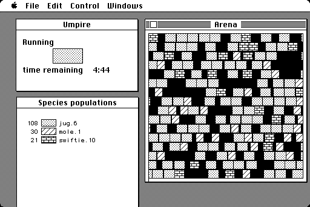

include::../../../config/revealjs-config.adoc[]
include::links.adoc[]

:figure-caption!:

:title: Вирусология
:section-history-title: Краткая история вредоносного ПО
:section-classification-title: Виды вредоносного ПО
:section-analysis-title: Методы анализа вредоносного ПО

// Слайд 1 - Титульник

[.center]
= Вирусология

[.title-slide-subtitle]
Осень 2025

[.title-slide-author]
Веричев Александр Владимирович

[.title-slide-author-links]
link:https://t.me/s/xanchelavederiver[@xanchelavederiver] alexanderverichev@gmail.com

// N.B. For now simply skipping the first and the third part - will be done for the next year
// region
ifdef::malware-history-skipped[]

// Слайд 2 - План

== План

**TODO**

. Краткая история вредоносного ПО
. Виды вредоносного ПО
. Методы анализа вредоносного ПО

// Слайд 3 - Заголовок раздела 1 (История развития)

== {title}

[.intro-malware-section-title]
--
[start=1]
. {section-history-title}

[start=2]
[.intro-malware-section-topic-greyed-out]
. {section-classification-title}

[start=3]
[.intro-malware-section-topic-greyed-out]
. {section-analysis-title}
--

// Слайд - Теория

== 1949-1971: Теоретические изыскания

* Концепция самовоспроизводящихся программ впервые была представлена венгеро-американским математиком и физиком Джоном фон Нейманом в серии лекций pass:[ ]"The theory and organization of complicated automata", прочитанных им в Университете Иллинойса в 1949 году
* В 1966 году университет опубликовал сборник лекций под названием pass:[ ]link:{von-neumann-automata}[Theory of self-reproducing automata]
* В работе рассматриваются вопросы организации и функционирования самовоспроизводящихся систем
* В качестве первого практического воплощения этой идеи выделяют игру Darwin

ifndef::notes-skipped[]
[.notes]
--
* В работе рассматриваются самоорганизующиеся автоматы - физические машины, собирающие машины
* Магистральная тема - сопоставление вычислительных устройств и естественных нейронных сетей
* Мозг образован существенно большим количеством узлов - нейронов
* Живые организмы имеют свойство размножаться - реплицировать себя (на самом деле даже развиваться со временем)
* Искусственные системы в теории также могут
* Коннективисты и аналогия мозг - ИНС
* Коннективисты не осилили придумать алгоритм обучения ИНС, а backprop им не понравился - мол, не похож на "естественный" механизм обучения
* Однако аналогии строения реализации искусственного интеллекта и естественных нейронных сетей - развитая сеть сложно соединённых нейронов, в частности, слоёв - живёт
* Очередное (отчасти маркетинговое) название - deep learning

'''
* As the very first modern computers were being built, pioneering mathematician and Manhattan Project contributor John von Neumann was developing the concept of a program that could reproduce and spread itself throughout a system. Published posthumously in 1966, his work, Theory of Self-Reproducing Automata, serves as the theoretical foundation for computer viruses.
--
endif::notes-skipped[]

// Слайд

[.columns.is-vcentered]
== 1969: Darwin

[.column]
--
«Дарвин» — компьютерная игра для программистов, разработанная в 1961 году сотрудниками Bell Labs В. А. Высотским, Дугласом Макилроем и Робертом Моррисом[англ.] для компьютеров IBM 7090, в которой несколько ассемблерных программ, названных «организмами», загружались в память компьютера. Организмы, созданные одним игроком (то есть принадлежащие к одному виду), должны были уничтожать представителей другого вида и захватывать жизненное пространство. Победителем считался тот игрок, чьи организмы захватывали всю память.

В начале 1980-х годов А. К. Дьюдни (A. K. Dewdney) разработал разновидность этой игры под названием «Бой в памяти» (Core War).
--

[.column.is-one-third.text-center]
--
."DARWIN68K" для Apple Mac pass:[ ]Gerald A. Edgar, 1987

--

// * link:{darwin-corewar}[[corewar.co.uk\] Core War: Darwin]
// * link:{darwin-wiki}[[Wikipedia\] Darwin (programming game)]
// * link:{darwin-survival-evolution}[McIlroy M.D., Morris R., Vyssotsky V.A. Darwin, a Game of Survival of the Fittest among Programs. 1971]

== 1971: Creeper worm
Just five years after John von Neumann’s theoretical work was published, a programmer by the name of Bob Thomas created an experimental program called Creeper, designed to move between different computers on the ARPANET, a precursor to the modern Internet. His colleague Ray Tomlinson, considered to be the inventor of email, modified the Creeper program to not only move between computers, but to also copy itself from one to another. Thus the first computer worm was born.

Although Creeper is the first known example of a worm, it is not actually malware. As a proof of concept, Creeper wasn’t made with malicious intent and didn’t damage or disrupt the systems it infected, instead only displaying the whimsical message: “I’M THE CREEPER : CATCH ME IF YOU CAN.” Taking up his own challenge, in the following year Tomlinson also created Reaper, the first antivirus software designed to delete Creeper by similarly moving across the ARPANET.

== 1982: Elk Cloner virus

Developed by Rich Skrenta when he was just 15 years old, the Elk Cloner program was intended as a practical joke. As a member of his high school’s computer club, Skranta was known among his friends to alter the games and other software shared among club members—to the point that many members would refuse to accept a disk from the known prankster.

In an effort to alter the software of disks he couldn’t access directly, Skranta invented the first known virus for Apple computers. What we’d now call a boot sector virus, Elk Cloner spread by infecting the Apple DOS 3.3 operating system and once transferred from an infected floppy disk, would copy itself to the computer’s memory. When an uninfected disk was later inserted into the computer, Elk Cloner would copy itself to that disk, and quickly spread among most of Skranta’s friends. While deliberately malicious, Elk Cloner could inadvertently write over and erase some floppy disks. It also contained a poetic message that read:

== 1986: Brain virus

While the Creeper worm was able to move across computers on the ARPANET, prior to the widespread adoption of the Internet most malware was passed along over floppy disks like Elk Cloner. However, while the effects of Elk Cloner were contained to one small computer club, the Brain virus spread worldwide.

Created by Pakistani medical software distributors, and brothers, Amjad and Basit Farooq Alvi, Brain is considered to be the first virus for the IBM Personal Computer and was initially developed to prevent copyright infringement. The virus was intended to prevent users from using copied versions of their software. When installed, Brain would display a message prompting pirates to call the brothers to receive the vaccination. Underestimating just how widespread their piracy problem was, the Alvis received their first call from the United States, followed by many, many more from around the globe.

== 1988: Morris worm

The Morris worm is another malware precursor that was created not for malicious intent, but as a proof-of-concept. Unfortunately for the creator, MIT student Robert Morris, the worm proved to be much more effective than he had anticipated. At the time, only about 60,000 computers had access to the internet, mostly at universities and within the military. Designed to exploit a backdoor on Unix systems, and to stay hidden, the worm quickly spread, copying itself over and over again and infecting a full 10% of all networked computers.

Because the worm not only copied itself to other computers but also copied itself repeatedly on infected computers, it unintentionally ate up memory and brought multiple PCs to a grinding halt. As the world’s first widespread internet cyberattack, the incident caused damages that some estimates placed in the millions. For his part in it, Robert Morris was the first cybercriminal ever convicted of cyber fraud in the United States.

== 1999: Melissa worm

While not as damaging as the Morris worm, about a decade later Melissa showed how fast malware can spread by email, infesting an estimated one million email accounts and at least 100,000 workplace computers. The fastest spreading worm for its time, it caused major overloads on Microsoft Outlook and Microsoft Exchange email servers resulting in slowdowns at more than 300 corporations and government agencies, including Microsoft, the Pentagon’s Computer Emergency Response Team, and roughly 250 additional organizations.

== 2000: ILOVEYOU virus
Necessity being the mother of invention, when 24-year-old Philippines resident Onel de Guzman found himself unable to afford dialup internet service he built a macro virus worm that would steal other people’s passwords, making ILOVEYOU the first significant piece of outright malware. The attack is an early example of social engineering and phishing. De Guzman used psychology to prey on people’s curiosity and manipulate them into downloading malicious email attachments disguised as love letters. “I figured out that many people want a boyfriend, they want each other, they want love,” said de Guzman.

Once infected, the worm did more than steal passwords, it also deleted files and caused millions in damages, even shutting down the United Kingdom’s Parliament’s computer system for a brief period. Although de Guzman was caught and arrested, all charges were dropped as he hadn’t actually broken any local laws.

== 2004: Mydoom worm
Similar to ILOVEYOU, the Mydoom worm also used email to self-replicate and infect systems around the world. Once taking root, Mydoom would hijack a victim’s computer to email out more copies of itself. Astonishingly effective, Mydoom spam once accounted for a full 25% of all emails sent worldwide, a record that’s never been broken, and ended up causing USD 35 billion in damages. Adjusted for inflation, it is still the most monetarily destructive piece of malware ever created.

Besides hijacking email programs to infect as many systems as possible, Mydoom also used infected computers to create a botnet and launch distributed denial-of-service (DDoS) attacks. Despite its impact, the cybercriminals behind Mydoom have never been caught or even identified.

== 2007: Zeus virus
First identified in 2007, Zeus infected personal computers via phishing and drive-by-downloads and demonstrated the dangerous potential of a trojan-style virus that can deliver many different types of malicious software. In 2011, its source code and instruction manual leaked, providing valuable data for both cybersecurity professionals, as well as other hackers.

== 2013: CryptoLocker ransomware
One of the first instances of ransomware, CryptoLocker is known for its rapid spread and powerful (for its time) asymmetric encryption capabilities. Distributed through rogue botnets captured by the Zeus virus, CryptoLocker systematically encrypts data on infected PCs. If the infected PC is a client in a local network, such as a library or office, any shared resources are targeted first.

In order to regain access to these encrypted resources, the makers of CryptoLocker requested a ransom of two bitcoins, which at the time were valued at roughly 715 USD. Luckily, in 2014 the Department of Justice, working with international agencies, managed to seize control of the malicious botnet and decrypt the hostage data free of charge. Unluckily, the CyrptoLocker program is also spread through basic phishing attacks as well and remains a persistent threat.

== 2014: Emotet trojan
Once called the “king of malware” by Arne Schoenbohm, head of the German Office for Information Security, the Emotet trojan is a prime example of what’s known as polymorphic malware making it difficult for information security specialists to ever fully eradicate. Polymorphic malware works by slightly altering its own code every time it reproduces, creating not an exact copy, but a variant that’s just as dangerous. In fact, it’s more dangerous because polymorphic trojans are harder for anti-malware programs to identify and block.

Like the Zeus trojan, Emotet persists as a modular program used to deliver other forms of malware and is often shared through traditional phishing attacks.

== 2016: Mirai botnet

As computers continue to evolve, branching out from desktop, to laptops, to mobile devices, and a myriad of networked devices, so does malware. With the rise of the internet of things, smart IoT devices present a vast new wave of vulnerabilities. Created by college student Paras Jha, the Mirai botnet found and took over a massive number of mostly IoT-enabled CCTV cameras with weak security.

Initially designed to target gaming servers for DoS attacks, the Mirai botnet was even more powerful than Jha had anticipated. Setting its sights on a major DNS provider, it effectively cut off huge swathes of the United States’ eastern seaboard from the internet for nearly an entire day.

== 2017: Cyber espionage

Although malware had already played a part in cyber warfare for many years, 2017 was a banner year for state-sponsored cyberattacks and virtual espionage, beginning with a relatively unremarkable ransomware called Petya. Although dangerous, the Petya ransomware spread through phishing and was not particularly infectious until it was modified into the NotPetya wiper worm, a program that looked like ransomware, but destroyed user data even if ransom payments were sent. That same year saw the WannaCry ransomware worm strike a number of high-profile targets in Europe, particularly in Britain’s National Health Service.

NotPetya is believed to be tied to Russian intelligence, who may have modified the Petya virus to attack Ukraine, and WannaCry may be connected to similar adversarial sectors of the North Korean government. What do these two malware attacks have in common? Both were enabled by a Microsoft Windows exploit dubbed Eternalblue, which was first discovered by the National Security Agency. Although Microsoft eventually discovered and patched the exploit themselves, they criticized the NSA for not reporting it before hackers were able to capitalize on the vulnerability.

== 2019: Ransomware-as-a-Service (RaaS)

In recent years, ransomware malware has both taken off and tapered off. Yet while the instances of successful ransomware attacks may be decreasing, hackers are targeting more high-profile targets and causing greater damages. Now, ransomware as a service (RaaS) is a troubling trend that’s gained momentum in recent years. Offered on dark web marketplaces, RaaS provides a plug-and-play protocol in which professional hackers conduct ransomware attacks in exchange for a fee. While previous malware attacks required some degree of advanced technical skill, mercenary groups offering RaaS empower anyone with ill intent and money to spend.

== 2021: A state of emergency

The first high-profile double-extortion ransomware attack took place in 2019, when hackers infiltrated security staffing agency Allied Universal, simultaneously encrypting their data while threatening to release the stolen data online. This extra layer meant that even if Allied Universal had been able to decrypt their files, they’d still suffer a damaging data breach. While this attack was noteworthy, the 2021 Colonial Pipeline attack is more notorious for the severity of the implied threat. At the time the Colonial Pipeline was responsible for 45% of the eastern United States’ gasoline and jet fuel. The attack, which lasted for several days, impacted both the public and private sectors along the east coast, and prompted President Biden to declare a temporary state of emergency.

== 2022: A national emergency

Although ransomware attacks may appear to be declining, highly targeted and effective attacks continue to present a chilling threat. In 2022, Costa Rica suffered a series of ransomware attacks, first crippling the ministry of finance and impacting even civilian import/export businesses. A following attack then took the nation’s healthcare system offline, directly affecting potentially every citizen in the country. As a result, Costa Rica made history as the first country to declare a national state of emergency in response to a cyberattack.

// Слайд - Заголовок раздела 2 (Классификация вредоносов)

== {title}

[.intro-malware-section-title]
--
[start=1]
[.intro-malware-section-topic-greyed-out]
. {section-history-title}

[start=2]
. {section-classification-title}

[start=3]
[.intro-malware-section-topic-greyed-out]
. {section-analysis-title}
--

endif::malware-history-skipped[]
// endregion

// Слайд - Определение термина "вредонос"

== Что такое вредоносная программа

// [.r-fit-text]
// --
* *Вредоносная программа* (_зловредная программа_, _вредонос_, _зловред_; *malware* - контаминация слов **mal**icious и soft**ware**) — любое программное обеспечение, предназначенное для получения несанкционированного доступа к вычислительным ресурсам самой ЭВМ или к информации, хранимой на ЭВМ, с целью несанкционированного использования ресурсов ЭВМ или причинения вреда (нанесения ущерба) владельцу информации, и/или владельцу ЭВМ, и/или владельцу сети ЭВМ, путём копирования, искажения, удаления или подмены информации {nbsp}link:{malware-definition-wiki}[[.intro-malware-inline-link]#Wikipedia#]
* *Malware* — зонтичный термин, объединяющий программы и сэмплы (_samples_ - фрагменты кода), предназначенные для причинения вреда компьютеру, сети или серверу {nbsp}link:{malware-crowdstrike}[[.intro-malware-inline-link]#CrowdStrike#]
* Вредоносные программы используются в атаках, целью которых является, среди прочего:
[.intro-malware-tight-list]
** извлечение выгоды - вымогательство, продажа конфиденциальных данных
** нарушение нормальной работы - DOS/DDOS атаки, удаление данных
** получение [конфиденциальных] данных - промышленный шпионаж, пиратство
** сделать заявление, привлечь внимание, заслужить _увожение_
// --

// Слайд - Виды вредоносов

[.columns.is-vcentered]
== Виды вредоносных программ

[.column]
--
[.intro-malware-tight-list]
* Вирус (Virus)
* Червь (Worm, Net-Worm)
* Логическая бомба (Logic Bomb)
* Рекламная закладка (Adware)
* Клавиатурный шпион (Key logger)
* Шпионские программы (Spyware, Stalkerware)
* Стиратель (Wiper)
* Вымогатель (Ransomware)
* Бэкдор (RAT – remote administration tool)
* Загрузчики (Drive-By-Download)
* Троян (Trojan)
* Руткит (Rootkit)
* Ботнет (Botnet)
* и многое другое
--

[.column.is-two-fifths.text-center]
--
[.intro-malware-tight-img]

[.intro-malware-tight-caption]
Вредоносы, холст, маслоpass:[ ]источник:{nbsp}link:{malware-types-kaspersky}[[.intro-malware-inline-link]#Kaspersky#]
--

// Слайд - Вирусы

== Вирус

* *Вирус* — самовоспроизводящийся программный код, который внедряется в установленные программы без согласия пользователя {nbsp}link:{malware-types-kaspersky}[[.intro-malware-inline-link]#Kaspersky#]{nbsp}link:{malware-virus-wiki}[[.intro-malware-inline-link]#Wikipedia#]
* Внедрение вируса происходит путём вставки своей копии в части существующих файлов
* Вирусы можно «подцепить» разными способами: от нажатия вредоносной ссылки или файла в неизвестном письме до заражения на вредоносном сайте
* Вирус может выполнять множество разных задач, направленных в первую очередь на принесение вреда операционной системе
* В настоящее время вирусы встречаются довольно редко в основном  по двум причинам:
[.intro-malware-tight-list]
** широкое распространение вирусного кода приводит к скорому попаданию в руки антивирусных компаний
** по большей части вытеснены другими видами вредоноснов, такими как черви и трояны
* Примеры вирусов: *The Creeper*, *Elk Cloner*, *Brain*, *Jerusalem*, *WinVir*,  *Bizatch*/*Boza*, *SCA*, ...

ifndef::notes-skipped[]
[.notes]
--
* Термины "червь" и "вирус" часто используются взаимозаменяемо
* Технически, черви также можно называть вирусами (т.е. червь - специальный вид вируса, "ленивый вирус")
* Часто главным отличием червя от вируса называют возможность распространятся самостоятельно - с машину на машину
--
endif::notes-skipped[]

// Слайд - Черви

== Червь

* Червь может считаться видом вируса, так как создан на основе саморазмножающихся программ, хоть и не способен заражать файлы {nbsp}link:{malware-types-kaspersky}[[.intro-malware-inline-link]#Kaspersky#]{nbsp}link:{malware-warm-cs}[[.intro-malware-inline-link]#CrowdStrike#]{nbsp}link:{malware-warm-wiki}[[.intro-malware-inline-link]#Wikipedia#]
* Червь поселяется в компьютере отдельным файлом или вовсе живёт в оперативной памяти (в таком случае его называют _резидентным_)
* Червь ищет уязвимости в системе для дальнейшего распространения
* Для распространения червь использует сеть (локальную или Интернет) и может заражать компьютеры разными способами: по электронной почте, через мессенджеры и т.п.
* Единицей заражения является компьютер целиком, а не отдельный файл на нём
* Главное отличие червя от вируса в том, что червь представляет собой своего рода транспорт для других вредоносных программ
* Например, после успешного заражения червь может «принести» на компьютер троян
* Примеры червей: *червь Морриса*, *SQL Slammer*, *Melissa*, *Concept*, *Mydoom*, *Zeus*, *Storm*, *Conficker*, *Duqu*, *ILOVEYOU*, *WannaCry*, *Code Red*, *Stuxnet*, ...

ifndef::notes-skipped[]
[.notes]
--
* Червь ищет уязвимости в системе или в человеке - т.к. может распространятся и через фишинг/смишинг
* Черви могут не только распространятся, но и выполнять DOS-атаки (съедать ресурсы - забивать RAM, диск - как форкобомба)
--
endif::notes-skipped[]

// Слайд - Трояны

== Троян

* В отличие от вирусов и червей, *троян* не самовоспроизводится и не распространяется самостоятельно - его предлагают загрузить под видом законного приложения {nbsp}link:{malware-types-kaspersky}[[.intro-malware-inline-link]#Kaspersky#]{nbsp}link:{malware-trojan-cs}[[.intro-malware-inline-link]#CrowdStrike#]{nbsp}link:{malware-trojan-wiki}[[.intro-malware-inline-link]#Wikipedia#]
* Нередко трояны действительно выполняют заявленные функции полезной программы, однако параллельно предоставляют полезные функции злоумышленникам
* Чаще всего трояны используются для сокрытия выполнения вредоносных и деструктивных действий от системы
* Современные трояны эволюционировали до таких сложных форм, как *бэкдор* или *RAT* (пытающийся взять на себя администрирование компьютера) и *загрузчик* (устанавливающий на компьютер жертвы вредоносный код)
* Примеры троянов: *Zeus*, *Zloader*, *QakBot*, *Andromeda*, *Vundo*, *Linux.Encoder*, *Mac Defender*, *AIDS*, *Emotet*, *DarkComet*, *TrickBot*, *LokiBot*, ...

ifndef::notes-skipped[]
[.notes]
--
* "Чистые" трояны обычно требуют пользовательских действий для установки
* Поэтому трояны распространяются через фишинг/смишинг и т.п.
* По типу выполняемых функций трояны далее подразделяются на руткиты/буткиты, RATы, загрузчики и т.п.
--
endif::notes-skipped[]

// Слайд - Руткит

== Руткит

* *Руткит* — особый вид вредоносных программ, разработанных специально для маскирования присутствия вредоносного кода и его действий от пользователя и установленного защитного программного обеспечения {nbsp}link:{malware-types-kaspersky}[[.intro-malware-inline-link]#Kaspersky#]{nbsp}link:{malware-rootkit-cs}[[.intro-malware-inline-link]#CrowdStrike#]{nbsp}link:{malware-rootkit-wiki}[[.intro-malware-inline-link]#Wikipedia#]

* С целью «спрятаться» руткиты тесно интегрируются с операционной системой и пользуются её механизмами
* Код руткитов выполняется на уровне ядра операционной системы, что позволяет им обходить большинство механизмов защиты - для сокрытия вредоносной деятельности им достаточно отказать в доступе средствам безопасности
* Некоторые руткиты, называемые *буткитами*, могут начать свою работу прежде, чем загрузится операционная система
* Руткиты достаточно трудно обнаружить и уничтожить, для этого применяют сложные современные антивирусные программы
* Примеры руткитов: *NTRootkit*, *Machiavelli*, *Zeus*, *Hacker Defender*, *Vanquish*, *Aphex*, *Cloaker*, *Spicy Hot Pot*, *FU*, *Knark*, *Stoned Bootkit*, *Olmasco*, *Rovnix*, *Stuxnet*, *Flame*, ...

ifndef::notes-skipped[]
[.notes]
--
* Троян может что-нибудь подчистить, но не всегда обладает достаточными правами (чтобы зачистить какой-нибудь сислог, например)
* Некоторые антивири могут выполнять сканировние также до загрузки ОС - эта идея очень давно обсуждается, существуют реальные примеры таких АВ
* Ещё один способ борьбы - виртуализация и контейнеризация среды исполнения приложений
--
endif::notes-skipped[]

// Слайд - Spyware

== Шпионящее ПО

* *Spyware* — категория вредоносных программ, без согласия пользователя собирающих и передающих данные об устройстве и выполняемых на нём действиях {nbsp}link:{malware-spyware-cs}[[.intro-malware-inline-link]#CrowdStrike#]{nbsp}link:{malware-spyware-wiki}[[.intro-malware-inline-link]#Wikipedia#]
* Классическим представителем spyware является *клавиатурный шпион* (*keylogger*) – особый вид трояна, который записывает все нажатия кнопок клавиатуры и/или действия мышки на вашем компьютере {nbsp}link:{malware-keylogger-cs}[[.intro-malware-inline-link]#CrowdStrike#]
* Чаще всего клавиатурный шпион применяется для кражи паролей и личной информации
* Ещё один популярный вид spyware — *Adware* — отслеживает действия пользователя в сети с целью оптимизации и таргетирования рекламных кампаний; аналогичный функционал выполняют т.н. *Tracking Cookies*
* *RedShell* — особо вредоносный вид ПО, устанавливаемые в систему вместе с какой-либо компьютерной игрой и отслеживающий онлайн-активность
* Примеры spyware: *CoolWebSearch*, *Agent Tesla*, *TrickBot*, *Zeus*, *Pegasus*, *FinSpy*, *DevilsTongue*, *Reign*, *Subzero*, ...

ifndef::notes-skipped[]
[.notes]
--
* Keylogger может применяться и корректно - как компонент SIEM-системы (Security Information and Event Management)
* Adware - это когда вы говорите "хочу новые лыжи купить", и через какое-то время вам везде в контекстной рекламе показывают лыжи
'''
* Commercial and state-sponsored spyware
** *Pegasus*: A powerful spyware from NSO Group that targets iOS and Android devices, capable of zero-click exploits.
** *FinSpy*: An advanced surveillance suite that can record calls and activate cameras.
** *DevilsTongue*: Developed by Candiru, this spyware is available for multiple operating systems including Windows, macOS, iOS, and Android.
** *Reign*: Another commercial spyware from QuaDream, primarily targeting iOS devices.
** *Subzero*: A spyware from DSIRF that targets Windows, with potential vulnerabilities in Adobe Reader and Google Chrome.
* General and high-profile malware with spyware capabilities
** *Agent Tesla*: A keylogger that has been used for many years to steal credentials.
** *TrickBot*: A banking trojan that can also be used to steal information.
** *Zeus*: A highly successful trojan that focuses on stealing financial information.
** *CoolWebSearch* (*CWS*): An early and aggressive browser hijacker that modified settings and redirected searches.
** *Gator*: A well-known example of early adware, which is a form of spyware.
** *Olympic Vision*: A keylogger that monitors keystrokes and is considered a type of system monitor spyware.
** *Storm Worm*: A sophisticated trojan horse that spreads via email and can have various capabilities, including keylogging.
--
endif::notes-skipped[]

// Слайд - Вымогатели

== Вымогатели

* *Вымогатель* блокирует доступ к компьютерной системе или предотвращает считывание записанных в нём данных, а затем требует от жертвы выкуп для восстановления исходного состояния {nbsp}link:{malware-ransomware-cs}[[.intro-malware-inline-link]#CrowdStrike#]{nbsp}link:{malware-ransomware-wiki}[[.intro-malware-inline-link]#Wikipedia#]
* Основными способами воздействия на жертву являются: блокировка или помеха работе (в системе или браузере), шифрование файлов и шантаж
* Нередко такие программы используют только разрешенные и безопасные функции системы, из-за чего средства безопасности просто не обращают на них внимания
* В случае применения средств шифрования, данные могут быть потеряны безвозвратно - такие виды вымогателей называют *Wiper* {nbsp}link:{malware-ransomware-viper-cs}[[.intro-malware-inline-link]#CrowdStrike#]
* Современные ransomware-атаки используют различные _Тактики, Техники и Процедуры_ (_Tactics, Techniques, and Procedures_, _TTPs_)
* Примеры: *CryptoLocker*, *NotPetya*, *Ryuk*, *REvil*, *WannaCry*, *Colonial Pipeline*, *Conti*, *Maze*, *DoppelPaymer*, *BlackCat*, *MOVEit*, ...

// **TODO**: добавить скрин с загрузчиком (и ещё пару примеров работы шантажиста)

ifndef::notes-skipped[]
[.notes]
--
* Говоря на языке волшебной триады, нарушается доступность и частично или полностью целостность данных (хотя нередко и конфиденциальность)
* Возможно, вымогатели - наиболее часто используемый вид вредоносов; во всяком случае атаки с их помощью на слуху, т.к. масштаб ущерба колоссален
* Их трудно заметить: пользователь открыл принадлежащий ему файл, изменил часть содержимого, закрыл - типичная операция; а то, что от имени пользователя действовал вредонос - система знать в общем случае не может
* Пример wiper - *NotPetya*
* Wiper-атаки могут быть формой т.н. хактивизма или эпизодом кибервойны между государствами (т.е. корыстные мотивы не являются драйвером атаки)
* TTPs современной атаки: получили доступ, закрепились, выполнили эксфильтрацию, зашифровали, шантажируем и/или продаём данные (double extortion strategy) и доступ (!) другим группировкам
'''
* *CryptoLocker* ransomware was revolutionary in both the number of systems it impacted and its use of strong cryptographic algorithms. The group primarily leveraged their botnet for banking-related fraud.
* *NotPetya* combines ransomware with the ability to propagate itself across a network. It spreads to Microsoft Windows machines using several propagation methods, including the *EternalBlue* exploit for the CVE-2017-0144 vulnerability in the SMB service.
* *Ryuk* WIZARD SPIDER is a sophisticated eCrime group that has been operating the Ryuk ransomware since August 2018, targeting large organizations for a high-ransom return.
* *Sodinokibi*/*REvil* ransomware is commonly associated with the threat actor PINCHY SPIDER and its affiliates operating under a ransomware-as-a-service (RaaS ) model.
* *WannaCry* has targeted healthcare organizations and utility companies using a Microsoft Windows exploit called *EternalBlue*, which allowed for the sharing of files, thus opening a door for the ransomware to spread.
* *Colonial Pipeline* In May 2021, a hacker group named DarkSide launched a ransomware attack on the Colonial Pipeline's IT network. The group exploited an exposed VPN account with a reused password, stealing 100 gigabytes of data within two hours. To isolate the operational technology systems from the compromised IT network, Colonial Pipeline shut down its operations, causing a disruption in fuel supply across the East Coast.  To regain control of its systems, the company paid a ransom of 75 Bitcoin, approximately $4.4 million at that time. This marked the largest publicized cyber-attack on US critical infrastructure. In response, the US government rolled out initiatives like stopransomware.gov and the Joint Ransomware Task Force to bolster the nation's cyber defenses.
* *Conti*’s utilization of compiler-based obfuscation techniques, such as ADVobfuscator, provide code obfuscation when the ransomware’s source code is built. Portions of Conti’s source code are restructured or rewritten regularly with the intention of avoiding detection and disrupting automated malware analysis systems.
* *Maze* ransomware targets multiple industries and organizations across the whole globe. It is relatively new and is known for releasing private data into the public if the victim of a ransomware attack does not give into the attacker’s demands.
* *DoppelPaymer* DoppelPaymer emerged in 2019, and unlike many ransomware campaigns that use automated systems for mass distribution, it is manually delivered after an initial network compromise. To maximize disruption, the attackers perform thorough network mapping, data exfiltration, and privilege escalation before initiating the DoppelPaymer ransomware. The ransomware uses multi-threading for faster encryption, and it can also operate offline, encrypting files without needing to communicate with its command and control servers. DoppelPaymer has been responsible for several high-profile attacks, random demands ranging from 2 to 100 Bitcoin, and data breaches leading to sensitive information being sold on the dark web.
* *BlackCat* ransomware is popular because it is one of the first professional ransomwares that was written in Rust, a more secure programming language. This makes it easier to customize the malware for different operating systems.
* *MOVEit* In May 2023, the Clop ransomware group executed a significant attack targeting the MOVEit Transfer software, a widely used tool for secure file transfers. The attackers exploited a zero-day vulnerability in the software, allowing them to gain unauthorized access to sensitive data from various organizations, including government entities, universities, and private companies. Clop not only encrypted files but also exfiltrated sensitive information, including personal data of employees and clients. The attackers utilized a double extortion strategy, threatening to release the stolen data if the ransom was not paid. As a result, many organizations faced significant reputational damage and legal implications, with some estimates suggesting the total ransom demands exceeded $100 million.
--
endif::notes-skipped[]

// Слайд - Botnet
//
// == Botnet
//
// ifndef::notes-skipped[]
// [.notes]
// --
// Botnet / Command & Control (C2): Network of compromised hosts controlled remotely for spam, DDoS, crypto-mining. Example: Mirai, Storm.
// Wikipedia
// '''
// + Botnet	Botnet is a network of computers infected with malware that are controlled by a bot herder. The bot herder is the person who operates the botnet infrastructure and uses the compromised computers to launch attacks designed to crash a target’s network, inject malware, harvest credentials, or execute CPU-intensive tasks.
// MALSPAM	Malicious malware (MALSPAM) delivers malware as the malicious payload via emails containing malicious content, such as viruses or malware-infected attachments.
// --
// endif::notes-skipped[]

// [bibliography]
== Источники

ifdef::malware-history-skipped[]

. link:{von-neumann-automata}[Von Neumann. Theory of self-reproducing automata. University of Illinois Press, 1966]

. Darwin
* link:{darwin-corewar}[[corewar.co.uk\] Core War: Darwin]
* link:{darwin-wiki}[[Wikipedia\] Darwin (programming game)]
* link:{darwin-survival-evolution}[McIlroy M.D., Morris R., Vyssotsky V.A. Darwin, a Game of Survival of the Fittest among Programs. 1971]

endif::malware-history-skipped[]

[.intro-malware-tight-list.intro-malware-text-90]
--
. link:{malware-definition-wiki}[[Wikipedia\] Вредоносная программа]
. link:{malware-crowdstrike}[[CrowdStrike\] Cybersecurity-101 - Malware]
. link:{malware-types-kaspersky}[[Kaspersky\] Классификация вредоносных программ]

. link:{malware-virus-wiki}[[Wikipedia\] Computer virus]
. link:{malware-warm-wiki}[[Wikipedia\] Computer worm]
. link:{malware-warm-cs}[[CrowdStrike\] Cybersecurity-101 - Computer worm]

. link:{malware-trojan-wiki}[[Wikipedia\] Trojan horse]
. link:{malware-trojan-cs}[[CrowdStrike\] Cybersecurity-101 - Trojans]

. link:{malware-rootkit-wiki}[[Wikipedia\] Rootkit]
. link:{malware-rootkit-cs}[[CrowdStrike\] Cybersecurity-101 - Rootkits]

. link:{malware-spyware-wiki}[[Wikipedia\] Spyware]
. link:{malware-spyware-cs}[[CrowdStrike\] Cybersecurity-101 - Spyware]
. link:{malware-keylogger-cs}[[CrowdStrike\] Cybersecurity-101 - Keylogger]

. link:{malware-ransomware-wiki}[[Wikipedia\] Ransomware]
. link:{malware-ransomware-cs}[[CrowdStrike\] Cybersecurity-101 - Ransomware]
. link:{malware-ransomware-viper-cs}[[CrowdStrike\] Cybersecurity-101 - Wiper attack]
--
